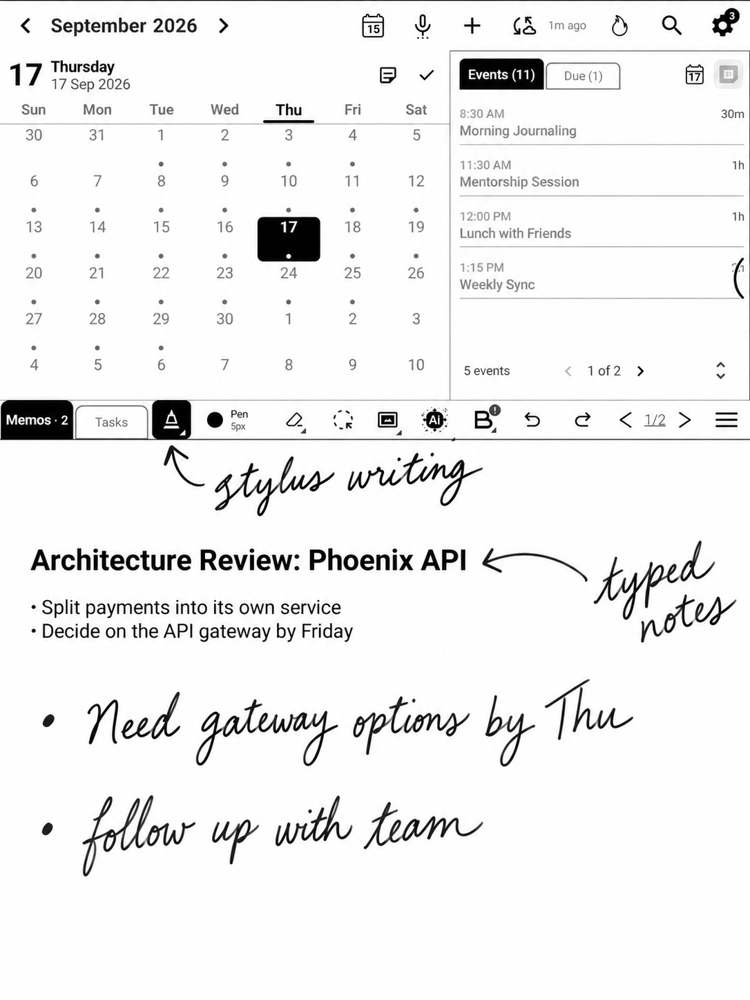
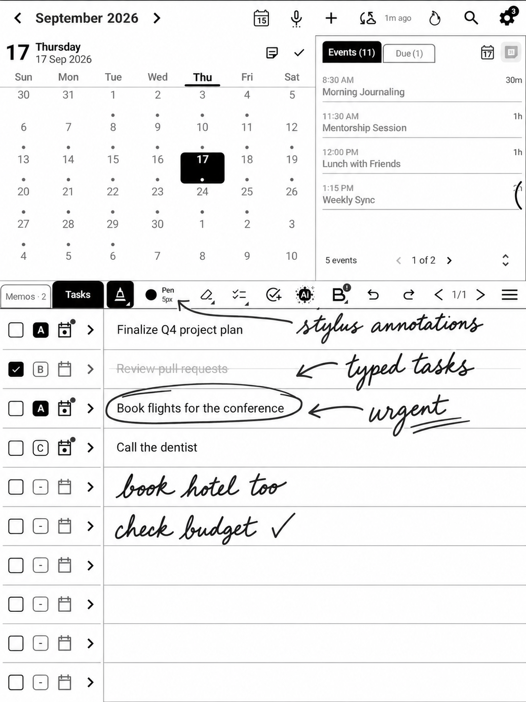
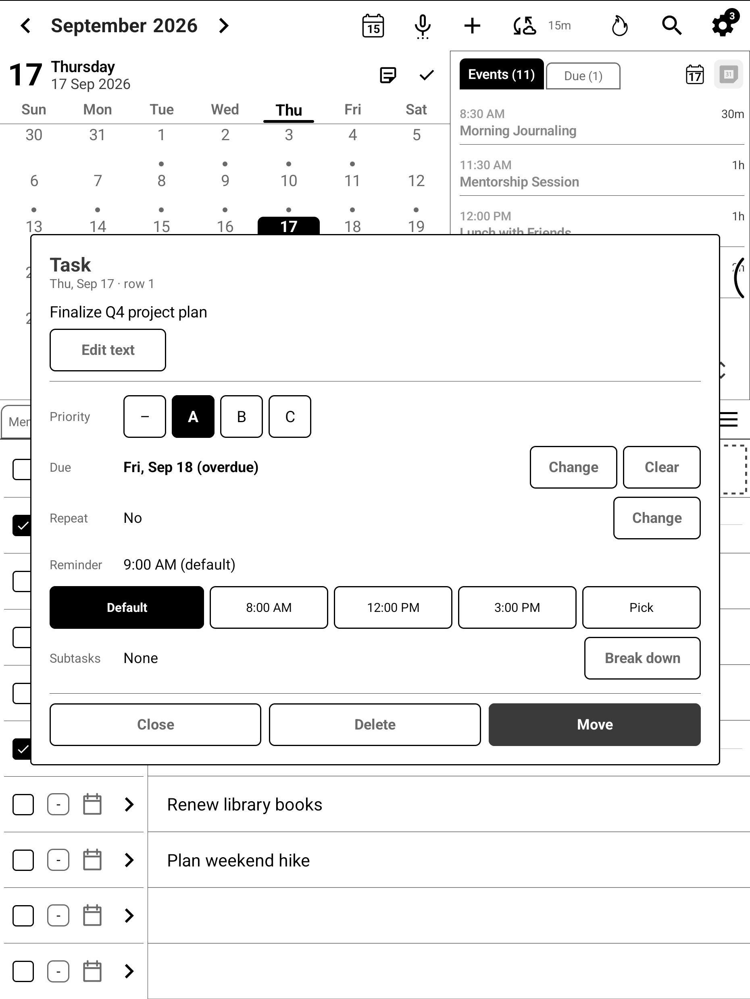
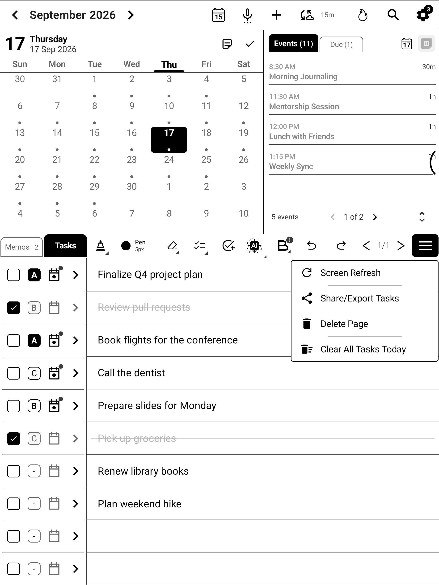

# BooxDay

A daily planner for Onyx BOOX e-ink tablets: a calendar, handwritten memos and handwritten task lists on one screen, made for the stylus and the e-ink display.

BooxDay is free and open source under the [GNU General Public License v3.0](LICENSE).

## Features

- Month calendar with the selected day's events and due tasks
- Handwritten Memos pages for each day, with text boxes, images and linked files
- Handwritten Tasks pages: ten rows a page, checkboxes, priorities, due dates, reminders, repeating tasks and subtasks
- Google Calendar and Outlook Calendar sync, or a calendar kept only on the tablet
- BOOX Notes integration: see your BOOX notes on the days they were written and link them to events
- Search across memos, tasks and notes
- Optional AI features (voice to event or task, handwriting to text, summaries, translation, task suggestions, search of handwritten pages) on your own [OpenRouter](https://openrouter.ai) account
- Connect OpenRouter in a few taps from the app, or paste a key you already have. Without credit, AI uses OpenRouter's free models
- Choose the AI model for each job, or leave Boox Day's choice. If your model fails, Boox Day's own model answers instead
- Designed for e-ink: no animations, high contrast, large touch targets

## Screenshots

| Memos | Tasks |
|---|---|
|  |  |
| **Task card** | **Toolbar menu** |
|  |  |

## Requirements

- An Onyx BOOX tablet running Android 10 or later. It has been tested on Boox Note Air4C, Air5C and Go 10.3, 10.3 gen II Lumi, Go 7 gen II B&W, Go 6 gen II B&W.
- For AI features: a free OpenRouter account. Connect it in Settings > AI Settings. The app has no AI key built in

## Install

BooxDay is free. It is not on Google Play, so you install it from an APK file. That is called "sideloading". It is a normal Android feature and it takes about two minutes.

**What you need:** a BOOX tablet with Android 10 or later, and an internet connection to download the file (about 100 MB).

### Step by step

1. **Download the APK.** On the tablet, open the [Releases](../../releases) page in the browser, find the latest version and tap `booxday-x.y.z.apk` under **Assets**. (You can also download it on a computer and copy it to the tablet over USB, into the Download folder.)
2. **If the browser warns about the file**, for example "This type of file can harm your device", tap **OK** or **Download anyway**. Android shows this for every APK from outside an app store.
3. **Open the file.** Tap **Open** when the download finishes, or open it from the Files app (Download folder) or the browser's download list.
4. **Allow installs from this app, once.** The first time, Android says something like "For your security, your tablet isn't allowed to install unknown apps from this source". Tap **Settings**, turn on **Allow from this source**, then press Back. The installer opens again. You are only allowing the app you opened the file from (the browser or Files), not everything.
5. **Tap Install.** If Android asks "Do you want to install this app?", confirm.
6. **If you see "Google Play Protect" or "Blocked by Play Protect"**: this is Google's automatic scan, and it shows up for apps it has not seen before. It does not mean the app is harmful. Tap **More details**, then **Install anyway** (or **Open anyway**). If it only offers "Scan app", tap that, wait for the result, then continue. You can leave Play Protect on.
7. **Tap Open**, pick your calendar (Google, Outlook or on the tablet only) and you are done.
8. Optional: for AI features, go to Settings > AI Settings and tap **Connect OpenRouter**.

### Good to know

- **"Unknown apps" setting.** If you missed the prompt, find it in Settings > Apps > Special app access > Install unknown apps (the exact name varies by tablet). Pick your browser or Files app and turn it on. You can turn it off again after installing.
- **"App not installed".** Usually the file did not finish downloading, so download it again. Also check there is free storage. If you have a copy of BooxDay that was installed some other way, uninstall it first (this removes its data, so back up first).
- **"There was a problem parsing the package".** The download is incomplete or damaged. Download it again.
- **Can't find the file.** Open the Files app and look in the Download folder.
- **Is it safe?** BooxDay is open source (GPL v3), has no server and sends nothing to its developer. You can read the code in this repository. Download only from this Releases page, never from other sites.
- **Updates.** BooxDay checks this Releases page when it starts. When a newer version is out, it asks whether to update, then downloads and installs it itself. The first time, Android asks you to allow installs from BooxDay (turn on **Allow from this source**, then come back). Your memos, tasks and settings are kept. Every release is signed with the same key, so updates install in place. You can also check by hand in Settings > About > **Check for Updates**. Versions 1.0.34 and earlier can't update themselves: install the next version by hand once, as above.

## Build from source

Requirements: JDK 17 or 21 and the Android SDK (compile SDK 36). Android 16 unit tests require JDK 21 (Robolectric 4.16).

```bash
./gradlew assembleDebug
adb install -r app/build/outputs/apk/debug/app-debug.apk
```

Release builds are signed with a key you provide, either through the environment variables `STORE_FILE`, `STORE_PASSWORD`, `KEY_ALIAS` and `KEY_PASSWORD`, or through a `keystore.properties` file in the project root (it is ignored by git).

Calendar sync needs your own OAuth setup if you build and sign the app yourself: a Google Cloud OAuth client for Android (package `com.boox.day` and your signing certificate's SHA-1), and for Outlook an Azure app registration, whose client ID and redirect URI go in `app/src/main/res/raw/auth_config.json`.

## Support

BooxDay is shared as is: there is no technical or product support. Bug reports and pull requests are welcome on the [Issues](../../issues) page, but there is no promise of a reply or a fix. The project is still being improved, and new versions are published on the [Releases](../../releases) page.

## Privacy

Your memos, tasks and calendar are stored on the tablet. BooxDay has no server and sends nothing to its developer. It goes online to download Google's on-device handwriting model and for the features you turn on: calendar sync (Google or Microsoft), backup to your own Google Drive, and AI features (OpenRouter, with your own key).

## Credits

BooxDay began as a fork of [Notable](https://github.com/olup/notable) by olup and contributors, also licensed under GPL-3.0.

Third-party code shipped with the app:

- [boox-note-parser](https://github.com/hhornbacher/boox-note-parser) by hhornbacher (Apache-2.0), included as a git submodule in `native/boox-note-parser`. With the JNI wrapper in `native/boox-note-android-ffi` it is built into `app/src/main/jniLibs/arm64-v8a/libboox_note_android_ffi.so`, which reads BOOX Notes.
- The Onyx BOOX SDK (pen, device and base libraries, including `libneo_pen.so`) from Onyx International Inc., used for the e-ink pen and screen, as Notable does. It is not covered by this project's license.

BooxDay is an independent project. It is not affiliated with, endorsed by or sponsored by Onyx International Inc., Google LLC or Microsoft Corporation. "BOOX" and "Onyx" are trademarks of Onyx International Inc.

## License

Copyright © 2024–2026 Flavio Ortolano.

This program is free software: you can redistribute it and/or modify it under the terms of the GNU General Public License as published by the Free Software Foundation, version 3. It is distributed WITHOUT ANY WARRANTY. See [LICENSE](LICENSE) for the full terms.
