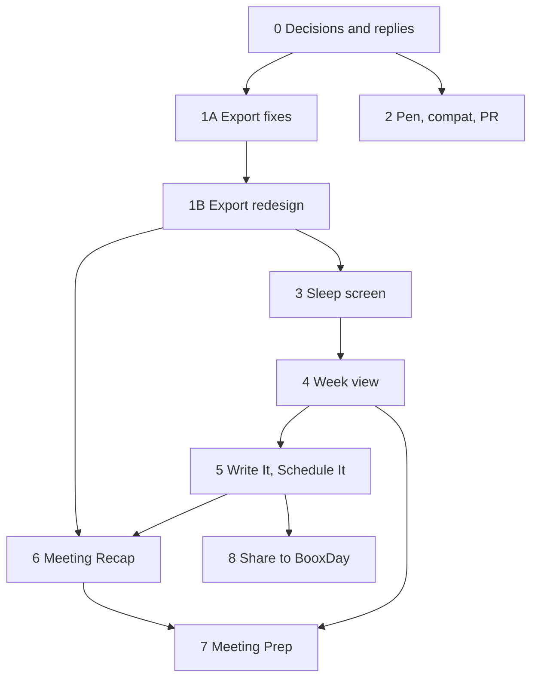

# BooxDay: Next Improvements Plan

**Status:** approved by the owner on 4 Nov 2026, with every decision taken (section 4). Phases 1A and 1B shipped on 5 Nov 2026 (1.0.61, 1.0.62); the phases after them are not built yet.
**Baseline:** `main` at `d8df4cc` (version 1.0.60, database v34).
**Scope source:** the owner's brief of 4 Nov 2026, based on Reddit feedback, GitHub issues and a code review.

---

## 0. How to use this document

This is the execution guide for coding sessions. Read it with the project's local `CLAUDE.md`, which holds the working rules, device notes and release steps. If this plan and `CLAUDE.md` disagree, stop and ask the owner.

**For a coding agent, in order:**

1. Read sections 1 to 7 once.
2. Find the first phase in the table below that is not done.
3. Check section 4. If a decision that blocks your phase is still open, ask the owner. Don't assume the recommended option: a recommendation is not a yes.
4. Do the phase's tasks in order. Tick its completion checklist.
5. At the end of a phase, update the table below and the "Decisions" column of section 4. Follow "How Phases 2 to 8 are done" below for branches and releases.

**Evidence labels used here:**

| Label | Meaning |
|---|---|
| Confirmed | Read in the code at `d8df4cc`. Not necessarily seen on a tablet. |
| Reported | A user said so. |
| Hypothesis | A reasoned guess. Prove it before acting on it. |
| Not run | Nothing was executed. No tablet was connected during this review. |

Paths are relative to `app/src/main/java/com/boox/day/` unless they start with `app/`, `docs/` or a repo-root file. Line numbers are from `d8df4cc` and will drift, so search by name.

### Phase status

| Phase | Name | Size (estimate) | Status |
|---|---|---|---|
| 0 | Decisions and first replies | Small, no code | In progress: decisions done; replies and baselines left |
| 1A | Export you can trust | Medium | Shipped in 1.0.61 (5 Nov 2026). Three tablet checks not done, by the owner's choice: see the phase's checklist |
| 1B | Export redesign | Medium | Shipped in 1.0.62 (5 Nov 2026). Saving to a picked folder and the Go 6 not checked, by the owner's choice: see the phase's checklist |
| 2 | Pen, compatibility and the Ukrainian PR | Small to medium | In progress on `next-release`: PR #5 merged there and the language screen rebuilt; eraser, issue #1 and SupportPopup left |
| 3 | Sleep screen choices | Small to medium | Built on `next-release`, pictures approved; tablet checks left |
| 4 | Week view | Large | Not started |
| 5 | Write It, Schedule It | Large | Not started |
| 6 | Meeting Recap | Medium to large | Not started |
| 7 | Meeting Prep | Medium | Not started |
| 8 | Share to BooxDay | Medium | Not started |

Phases 1A and 1B shipped as their own releases. **Phases 2 to 8 ship together as one release** (owner, 5 Nov 2026).

### How Phases 2 to 8 are done (owner, 5 Nov 2026)

**Three parts, built in this order.** The phase sections below keep their numbers and details; only the grouping is new.

| Part | Phases | Why they belong together |
|---|---|---|
| 1. Everyday fixes | 2 Pen and compatibility, 3 Sleep screen | Small and independent of everything else |
| 2. Planning | 4 Week view, 5 Write It, Schedule It | Phase 5 needs the overlay host and main-screen requests that Phase 4 builds |
| 3. Meetings and sharing | 6 Recap, 7 Prep, 8 Share | All three reuse the proposal model and review sheet from Phase 5 |

**One release at the end.** Work stays on its own branch until all three parts are done and checked. The usual "tested work ships" step (`CLAUDE.md` rule 8) doesn't apply to these phases. A bug found in 1.0.62 is fixed on the branch and waits for this release too: no separate fix release (owner, 5 Nov 2026).

**Other agents work on this app too.** So that this work doesn't affect theirs:

- Work in a separate worktree and branch, never in the main checkout and never on `main`.
- No version bump, tag, GitHub release, website change or push to `main` until the one release. The version number is taken then, after whatever others have shipped.
- Bring `main` into the branch regularly, and resolve conflicts here. Never rewrite or force-push anything shared.
- Before editing a file another agent has open, look at the worktrees (`git worktree list`, `git status` in each). Boox Notes files belong to the Boox Notes work for now: `booxnotes/`, `ui/dialogs/BooxNote*`, `ui/dialogs/BooxNotes*`, `ocr/semantic/SemanticGeniusService.kt`.
- Keep changes to shared files small: `MainScreen.kt`, `Toolbar.kt`, `EInkTheme.kt`, `AppSettings.kt`, strings, Help. `MainScreen` and `SharedToolbar` have one size limit between all agents, so measure after each merge from `main`.
- No database change without agreeing the version number first. This plan needs none.
- Before driving or installing on a tablet, check that no other session is testing there, and that the owner isn't using it. Debug builds keep the version number of `main`.

### Rules that bite in this work

From `CLAUDE.md` and the owner's brief. The full text wins.

- **The owner decides.** Options, reasons, a labelled recommendation, then wait for a yes.
- **UI goes as pictures first** (rule 5). Every phase with new UI starts with render-test pictures at each screen size for the owner's OK. This is the existing rule, not an extra step.
- **Re-read a file right before editing it.** Other sessions work in this repo. Check `git worktree list` and `ListAgents`. Commit with explicit paths, never `git add -A`.
- **Bugs:** state the root cause with file and line evidence before fixing. A confirmed bug gets fixed, tested and shipped.
- **Tests are focused** (rule 7): one test per decision or real risk. Run only the changed classes. Run the feature's package once before a merge. Never the whole suite unless asked.
- **Tested work ships without asking:** commit, merge, push, release.
- **Exceptions, from the brief:** no GitHub or Reddit posts, and no closing issues, without the owner's approval. Website wording also needs the owner's OK (Releases step 9).
- **Never run `connectedAndroidTest`:** it wipes the app. Ask before anything that wipes data. Installing in place needs no asking.
- **Add nothing to pen hot paths:** `onRawDrawingTouchPointMoveReceived()`, `handleDraw()`.
- **Protected fixes** (table in `CLAUDE.md`) need the owner's OK and full understanding. The erase row is open for Phase 2 only, on the condition stated there (D3). Nothing else in this plan needs a protected fix.
- **Method limits:** `MainScreen` is at 15,963 of 16,383 dex units, and its root lambda is at the JVM limit. New UI goes outside it (see S4, S5).
- **E-ink UI:** `Popup` not `Dialog`, `noRippleClickable`, vector icons, `EInkTheme` tokens, `docs/DIALOG_RULEBOOK.md`, `EINK_UI_UX_GUIDE.md`.
- **Never log** AI prompts, AI answers, user text or shared text as warning or error. Log lengths.
- **Don't promise what isn't verified.** No compatibility or fix claim without evidence.

---

## 1. Goal and scope

**Goal:** make BooxDay a more useful, smarter and more polished daily planner, without losing its simplicity, speed or handwriting feel.

### In scope

| # | Work | Phase |
|---|---|---|
| 1 | Export fixes for PDF, PNG and JPG, plus an audit of other export problems | 1A |
| 2 | Compatibility and pen issues (#1, #3), the Ukrainian PR (#5), GitHub and Reddit replies | 0, 2 |
| 3 | Customizable sleep screen | 3 |
| 4 | Week view | 4 |
| 5 | Write It, Schedule It | 5 |
| 6 | Meeting Recap | 6 |
| 7 | Meeting Prep | 7 |
| 8 | Share to BooxDay | 8 |
| 9 | Export redesign: what to export, formats, where it goes, a new dialog | 1B |

### Out of scope

- **Translating the app** (owner, 4 Nov 2026). Note for later: about 2,000 pieces of text sit in the code, and only 8 of 588 Kotlin files use string resources. New code in this plan should not make that worse, but needn't solve it.
- **Landscape.** The app is portrait only (`AndroidManifest.xml`: both activities). The brief says "where supported", so no landscape work and no landscape tests.
- **Plan my week, Ask BooxDay, meeting audio recording.** Proposed earlier, not in the owner's list.
- **Microsoft To Do** (owner: later).
- **PowerPoint and Word export, and direct links to services such as Notion or OneNote** (owner, 4 Nov 2026). Share, Save and Markdown reach those apps with no accounts. AI stays out of normal export.
- **Clean-ups for their own sake:** dead Layout B code, Book export, XOPP, `autoExport`. Leave them unless a task needs them.

### Terms used in this plan

| Term | Meaning in the code |
|---|---|
| Row day | `Task.dayDate`: the day a task's row sits on. Always set. |
| Due day | `Task.dueDay`: an optional deadline. Overdue starts the day after. |
| Reminder | `Task.reminderMinuteOfDay`: only scheduled when there is a due day. |
| Scheduled task | **Not a code term.** No task has a time of day. In this plan it means a task with a row day, usually a due day, and sometimes a reminder time. |
| Meeting | A calendar event with Memos pages linked to it through `Page.linkedEventId`. |
| Proposal | Something AI suggests creating: an event, task or note. Nothing is created until the user accepts it. |

---

## 2. What the app does today (verified)

Confirmed by reading the code at `d8df4cc`, unless labelled. A second pass checked the most important claims directly. **Not run** applies to everything here.

### 2.1 Export

- **Paths in use:** ≡ > Export Pages (`editor/ui/toolbar/ToolbarMenu.kt`), then `ui/dialogs/ExportDialog.kt`: PDF, PNG or JPG; current page or all pages; for PDF, Compact layout or One memo per page.
- **Engines:** `io/ExportEngine.kt` (one per page, images) and `io/CompactExportEngine.kt`.
- **Text boxes are lost everywhere:** `PageData` holds strokes and images only (`ExportEngine.kt`, `PageData`; `drawPage`; `renderBitmapForPage`), and Compact draws the same (`renderPageBitmap`). Attachment chips are lost too.
- **Meeting headers are text boxes** (`sync/EventMemoService.kt`, `addEventHeader`, source `event_memo_header`), so a meeting's title and time never reach an export.
- **Text-only pages:** Compact skips them (`measureContentBlock`) and may answer "No content to export".
- **Bounds ignore text:** `computeContentDimensions`, `findContentTop/Bottom`. Just drawing text boxes would crop headers above the ink.
- `ai/MemoPageContent.kt` already loads text boxes, handles negative coordinates and has a writer barrier for unsaved work. Export has none of this.
- `drawTextAnnotation` works on a scaled plain canvas off the main thread. Trap: its `scroll` argument is the view corner and is subtracted, the opposite sign to `drawStroke` and `drawImage` offsets.

**Other confirmed export bugs:**

| Bug | Where |
|---|---|
| PNG and JPG report success even when saving failed: the `saveBytes` result is dropped | `exportAsImages` |
| An exception outside `saveInternal` goes to a scope with no handler: the app can crash | `ui/SnackBar.kt`, `ToolbarMenu.kt` |
| One per page opens the old file for writing before rendering: a failure destroys the old export | `saveInternal` |
| `overwrite = false` has no effect: exports silently replace files | `createOrGetFileInDir`, `savePdfDocument` |
| Export replaces the clipboard with a junk link (default `copyToClipboard = true`) | `copyPagePngLink` |
| Compact holds every page bitmap at once and recycles only on success | `exportCompactPdf` |
| Compact block taller than the A4 area is cut off, not split | `packContentBlocks` |
| Ink wider than the screen is cut in both PDFs: a Go 10.3 memo opened on a Go 6 loses its right side | `writePageToPdfDocument`, `renderPageBitmap` |
| Ink at negative coordinates is cut | same |
| A magenta line may appear at the right edge of One per page (`marginPaint` in `editor/drawing/backgrounds.kt`). Check on a real PDF. | `backgrounds.kt` |
| The snack says "Exporting the page" even for a whole day; PNG and JPG results don't name the folder | `ToolbarMenu.kt`, `exportAsImages` |
| Error wording differs; Compact shows raw paths | `saveInternal`, `savePdfDocument` |
| Tasks export: the ink check reads memory only, so unread handwriting on unloaded pages drops out of This Month and All Tasks; it runs on the main thread | `io/TaskExportService.kt`, `taskHasRealContent` |

**Possible, needs a device:** Android 11+ without All Files Access; a file left by an old install giving EACCES; Pencil strokes on a PDF canvas; memory on a large day on the Go 6.

**No way to share an export.** The file is saved, and the user must find it. The pieces exist: `Documents/` is in `res/xml/file_paths.xml`, the FileProvider authority is `com.boox.day.provider`, and `SnackConf` takes actions. But `export()` returns only a String.

**Tests:** none for either engine. Robolectric has no PDF classes, so test on bitmaps. Template: `MemoPageContentTest`.

### 2.2 Lasso and selection

- `editor/ui/SelectorBitmap.kt`, `SelectedBitmap`: the floating bar shows Delete, AI Recognize, Cut, Copy, Duplicate, Convert to Tasks. Icons only, 35 dp each. Six on Memos, five on Tasks.
- Position: left edge of the selection, clamped to 8 dp margins, above it, or below when above doesn't fit. No overflow handling: `buttonCount` is set by hand and must match. A seventh button makes it 251 dp wide, which fits every screen.
- Lasso selects strokes, images and attachments. **It never selects text boxes.**
- Convert to Tasks path: strokes are captured, the selection resets, then `MainScreen` runs `MemoToTasksService.convertSelectionToTasks`: `MemoPageContent.renderSelection`, vision read (`ocr_text`), `refineText`, then `memo_to_tasks`.
- `requireKey()` is called with no resume after the selection is gone, so without a key the user must lasso again.
- The processing dialog has a **9-second minimum** and no cancel.
- Task text in its results dialog **can't be edited**.
- `suggestedTime` is parsed and never used. A date written in the ink sets nothing.

### 2.3 Events and event creation

- `ai/VoiceEventParser.kt` turns speech into `data/model/ParsedEventData`. It uses a prompt format, not a schema, and relative dates are left to the model. It infers attendees and description.
- There is **no separate preview**: `AddEditEventDialog` opens prefilled. It has one call site, in `MainScreen`, on `MainScreen` state (`parsedEventData`, `showAddEventDialog`).
- Saving logic sits inside that call's `onSave` lambda (calendar choice, account). Default calendar logic sits inside the dialog. Neither can be used from outside today.
- **Nothing turns ink into an event, under any name.**
- CalDAV guests are never written (owner decision 62). AI must not add guests anywhere.

### 2.4 Calendar screen and pen control

- Upper section 40% height: calendar and events panel. Canvas 60%.
- `LayoutProfiles` (`ui/theme/LayoutProfile.kt`): `isNarrowScreen` below 600 dp, `isSmallTablet` at 300 dpi. A Go 7 at about 674 dp is not narrow but is small. No class for 13.3-inch.
- Layout B is dead code: `current` is fixed to Regular.
- The top bar has about 10 dp free on the Go 6 and 13 dp on the Go 7 (arithmetic). `DayHeader` has about 50 dp free on the Go 6: the only spare spot common to all sizes.
- **Overlays:** `Popup`s driven by `MainScreen` state or by global-state hosts (`ActionItemsHost`, `MeetingNotesHost`, `SupportPopupHost`). No edge-to-edge popup exists yet.
- **Pen while an overlay is open:** `isMainScreenModalBlockingCanvas` feeds `DrawCanvas.mainScreenModalVisible`, which calls `setRawDrawingEnabled(false)`. A new overlay must join this list or the pen writes through it.
- **Candidate bug:** `SupportPopup.isOpen` is not in that list.
- **Selecting a day has side effects:** it creates memo pages and task pages, and places recurring tasks. A Week view must not read through that path.
- `viewingCalendar` is not updated by every jump, so going to a day in another month can leave the grid on the old month (Search too).

### 2.5 Week data

- **No Week view, agenda or week loader exists.** Weekly Summary is a stats dialog in the Tasks AI menu.
- Exact calendar event rule: `EventsViewModel.getEventsForDateSync(day)`. It honours hidden calendars, the source filter and tablet copies. `CalendarEventDao.getByDateRange` ignores hidden calendars, so **don't use it for display**.
- Recurring events are stored as rows from all three services. Recurring **tasks** have no rows until the day is visited. A preview needs `getActiveTemplatesForDate` and `shouldGenerateOnDate`.
- `getTasksForDateRange` includes blank slots and has no order. `getTasksDueBetween` exists at DAO level.
- **Trap:** `taskHasRealContent`'s ink check fails on unloaded pages. Use `HandwrittenRows` (`share/TasksFeedProvider.kt`).
- Handwritten rows as pictures: `StartDayReviewLoader.renderRowInk` works, for rows 0 to 9, and reads all the page's strokes per call. Cache per page.
- Paged, non-scrolling list model: `StartDayReviewPopup` ("Paginated, no scrolling"). Move template: `reviewMove`, `moveTaskWithStrokes` (refuses reflowed days). Tick template: `reviewDone`, with `TasksCanvasRefresh.hold/release`.
- First day of week: use `AppSettings.FirstDayOfWeek.weekStart()`. Weekly Summary uses the locale instead, which is a mismatch.
- **The Due tab exists** beside Events: tasks with a due day, plus overdue on today. Tap goes to the task. No ticking there.

### 2.6 Sleep screen

- `sleepscreen/`: one on/off setting (`sleepScreenAgendaEnabled`). No content choice.
- `SleepAgendaLayout.plan` drops things in a fixed order. The month calendar appears only if free space is left.
- The memo panel never shows on compact screens (Go 6, Go 7).
- `SleepScreenPublisher` skips a redraw when `fingerprint` matches. A content setting must join the fingerprint.
- **Candidate bug:** `today/DayDigestLoader.events` removes duplicates on the raw `LocalEvent.id`, but tablet copies of synced events keep a UUID plus `providerEventId`, and `EventsViewModel` compares the mapped id. So the sleep screen and Daily Notes may show such events twice. Prove it with a test first.
- `AppSettings` is JSON with `ignoreUnknownKeys`, so new fields with defaults need no migration.

### 2.7 AI

- **Path:** `ModelConfigProvider.getChain(job)`, `AiRetryExecutor.execute`, `AiClient.execute`.
- **Jobs:** HANDWRITING, VOICE, WRITING, PLANNING, SEARCH_INDEXING. No new job is needed. A new job would touch the model settings and checks.
- **Gates:** `AiKeyGate.requireKey(resume)` and `withKey`; `CalendarAiNotice.awaitAllowed()` for anything that sends calendar data (once per install).
- **`AiClient.execute` does not check `aiEnabled`.** Only `AiKeyGate` and indexing do. Any AI entry that skips the gate would break the promise of the AI off switch.
- **Call order** (Weekly Summary is the model): grey the button when off, check cache, `requireKey(resume)`, notice if events go, build context, `AiRetryExecutor.execute`, show. On failure, `LastAiProblem.noteShown`, Retry. Raw drawing stays off while open.
- **Schemas:** `ai/StructuredOutputSchemas.kt`, every field required, "" or [] for none. Add to `inUse` in `StructuredOutputSchemasTest`, and add a step name in `LastAiProblem`.
- **Cost:** no request de-dupe. Summarize has no cache and takes about 3 calls per page. `summary_cache` is used by Daily and Weekly with a content hash, but rows can be cleared, so it's not safe as the only copy.
- **Review UIs:** none lets the user edit item text. Convert to Tasks' `ExpandableTaskItem` is the closest.
- `RotatingFunMessage` is reusable. Daily and Weekly section components are private.

### 2.8 Meetings

- **More exists than the brief assumes.** Event details has a Meeting notes card (`meetings/MeetingNotes.kt`). The Memos toolbar has a Meeting notes button. Later pages join a meeting through next-page on its last page.
- **Action items** (`actionitems/`): on-tablet ML Kit plus English rules, no AI, no cost.
- **Link:** `Page.linkedEventId`, indexed text, no foreign key. `EventMemoService.getLinkedMemo` returns a meeting's pages.
- Recurring events: each occurrence has its own id and its own notes. **No series id or organizer is stored.** Tasks have no event column.
- If an event is deleted, the link dangles and the notes stay.
- **Candidate bug:** when a tablet event is pushed and gets a provider id, the memo link is not updated. Prove it with a test.
- **Trap:** a page linked to a meeting joins `getLinkedMemo`, and only the header source is filtered (`actionitems/MemoPageText.kt`). A saved recap on a linked page would be read back as notes.
- Saved OCR text: `UnifiedOcrRepository.getOcrText(OcrSource.MEMO, date, pageId)` is a local read, but it's only filled when AI page reading is on (off by default).
- Local helpers: `TaskEventMatcher.findRelationships`, `BooxNoteRepository.getNotesLinkedToEvent`, `SemanticGeniusService.findRelatedContent`. `MemoContextExtractor` is not event-aware: avoid it.

### 2.9 Android sharing

- **No `ACTION_SEND` filter exists.** The only send code is outbound.
- `MainActivity` uses standard launch mode: every intent aimed at it builds a new activity and a second canvas, while the pen helper is process-wide.
- `OpenRouterConnectActivity` shows the safe pattern: its own light activity, then `backToApp()` with `NEW_TASK | CLEAR_TOP | SINGLE_TOP`.
- `TaskFocusRequests` shows the safe hand-off: a pending `StateFlow` that survives a cold start. `MeetingNotesUi.pages` has no replay, so it would lose early events.
- A cold start through another activity runs `BooxDayApp.onCreate` only: settings aren't loaded and `SCREEN_*` hold defaults.
- No web page fetch exists anywhere. A link stays text.
- A frozen BooxDay likely vanishes from the share sheet (inference).

### 2.10 GitHub issues and PRs

**Issue #1, Tab Ultra C white screen (open, no reply).**
- `docs/BOOX_FEEDBACK_FIX_PLAN.md` records 4 reports, all on Tab models with Android 11.
- The issue was filed on 16 Oct, **before** 1.0.33 changed the Router (19 Oct). That change targets this very symptom.
- Bernard_Svart said on Reddit it still fails, but the version is unknown.
- The owner's earlier rule: no startup code unless proven.
- Startup code doesn't branch by Android version below R, so 11, 13 and 15 take the same path.
- The pen area of about 70% is not explained by app maths.
- Ranked hypotheses are in Phase 2.

**Issue #3, eraser to pen (open, no reply).** Every code claim checks out at HEAD:
- `setEraserTrail` sends DASH.
- Nothing restores the pen style when the eraser lifts on the normal backend (`onEndRawErasing`, `resumePenRenderAfterErase`), while BOOX Notes reapplies pen settings before resuming.
- A stroke that starts during the 300 to 550 ms pause gets no live ink for its whole length, because resume waits for pen-up.
- This is a protected fix. D3 opens it for Phase 2.

**Issue #4, CalDAV (open).** Shipped in 1.0.53. Tested with iCloud and Radicale, **not Nextcloud**, which is what the issue asks for.

**PR #5, Ukrainian handwriting (open).**
- Correct and applies cleanly to `d8df4cc`.
- ML Kit has the `uk` model. The PR covers all 3 language lists.
- Risk: 11 languages make a sixth row in `LanguagePackManagerPopup` in a column that doesn't scroll. Arabic could clip on the Go 6.
- The author hasn't built it, and neither have we.

### 2.11 Help, website, repository

- `ui/dialogs/HelpDialog.kt`: 13 sections, text only.
- `tips/TipsRepository.kt`: 89 tips by context.
- README: features, requirements, install. Its Android claim is "Android 10 or later". It lists tested tablets but not the Note Max.
- There is no changelog file: GitHub release notes serve as the changelog. Five pictures in `docs/images/`.
- Website: homepage feature cards and lists, a "What's new" card, FAQ, privacy page. Its AI list and calendar lines need updates as features ship.

---

## 3. Where this plan differs from the brief, and why

The brief asked for judgment. These are the changes I recommend. Each is in section 4 if it needs a yes.

1. **No new database table anywhere.** All eight items fit on database v34: settings go in `AppSettings` JSON, recaps go in text boxes, prep is computed, shared items wait in files. No migration means no risk to users' data. This is the strongest protection available.

2. **Don't add times to tasks.** "Scheduled tasks" sounds like tasks with a time, but BooxDay deliberately has a due day and a reminder. A written time becomes a reminder time on the due day. This matches what Task Sync already does (decision 69).

3. **Week view is an overlay, not a new route.** Leaving the main route disposes the canvas. An overlay keeps the pen session open, so closing it is instant.

4. **Week view cells aren't individually tappable.** Tiny tap targets fail on e-ink with a finger. A whole day cell is one big target that opens a Day sheet, where rows are full size. Glance first, act second.

5. **One shared review sheet, not three.** Write It, Share and Recap all end in "here are things to create, check them". One proposal model and one review sheet serve all of them, and this one sheet makes item text editable.

6. **Meeting Prep works without AI.** Most of the value is local: last time's notes, open tasks, linked BOOX notes. That costs nothing, works offline and sends nothing. AI is one optional button.

7. **Recap reuses Action items, not replaces it.** The on-tablet Action items stay as the free, offline path.

8. **Share goes last.** Nobody on Reddit asked for it. It's independent, so it can move or be dropped without touching anything else.

9. **Links are not fetched.** Share keeps a link as text. Fetching pages would add a new network path and a privacy change for little gain.

10. **Issue #1 is not proven to still exist.** The first step is asking the reporter for the version, not writing code.

11. **One layout stays, and each size adapts its density.** `CLAUDE.md` says device differences are sizes only. The brief says don't just shrink. The two fit together: Week view keeps the same grid on every size (D7), and each size adapts its header, time format and lines per day.

12. **No Go 7 or Note Max is on hand.** "Validated on 7-inch" can only mean render tests at the real size plus community testers. The plan says so plainly and doesn't claim more.

13. **Export grows by fitting real jobs, not by adding file types.** The owner asked whether to add Obsidian, other integrations, and AI slides. Obsidian is in, through Markdown files. AI slides, Word and direct service links are out: they add cost and upkeep, and the same result is reachable through Share, Save and Markdown.

---

## 4. Decisions needed from the owner

Answers go in the "Decision" column. Until then a decision is open, and the recommended option is only a recommendation.

| ID | Question | Options (gain / cost) | Recommendation | Blocks | Decision |
|---|---|---|---|---|---|
| D1 | Is the order right? | **A.** Reliability, Sleep, Week, Write It, Recap, Prep, Share (section 5). **B.** Move a feature earlier. | A | All | **A (owner, 4 Nov 2026).** |
| D2 | A file with the same name exists | **A.** New numbered copy, `...-2.pdf` (never destroys anything / more files). **B.** Replace it, as today (tidy / an older export is lost). | A | 1A | **A (owner, 4 Nov 2026).** |
| D3 | May Phase 2 touch the protected erase code? | **A.** Only reapply the pen style just before ink resumes; timing untouched (small, matches BOOX Notes / needs tablet checks). **B.** Also resume ink mid-stroke (fixes the delay fully / risks erased ink flashing back). **C.** Leave it. | A, then decide on B after testing | 2 | **A (owner, 4 Nov 2026).** The erase row is open. Condition: nothing from this area ships until the owner has passed the tablet checks with the real pen. Option B needs a new decision. |
| D4 | If the reporter confirms issue #1 on the latest version | **A.** Publish a diagnostics APK as a GitHub pre-release; never offered in-app (real evidence / extra build). **B.** Wait for more reports. **C.** Also install an Android 11 emulator on the PC (catches plain Android 11 faults, not BOOX ones / a new install on your PC). | A; C only if you want it | 2 | **A (owner, 4 Nov 2026).** No emulator. |
| D5 | Merge PR #5? | **A.** Yes, after a build and the Go 6 fit check. **B.** Ask the author for changes first. | A | 2 | **A (owner, 4 Nov 2026).** |
| D6 | Sleep screen: what does the Month switch mean? | **A.** Existing users keep today's "when there's room" until they change the switch; after that it's always on or off (no change for anyone until they choose / one hidden state). **B.** Always on or off for everyone from now (simple / changes some sleep screens on update). | A | 3 | **A (owner, 4 Nov 2026).** |
| D7 | Week view on 6-inch screens | **A.** Seven stacked rows (about 3 lines a day, titles to about 55 characters / an exception to "one layout"). **B.** The same two-column grid, with density adapted (about 5 lines a day, one layout, less code / titles end at about 28 characters). **C.** Two pages of four days (roomy / never a whole-week view). | B | 4 | **B (owner, 4 Nov 2026).** Pictures of A and B with real titles come first in Phase 4. |
| D8 | How do people open Week view? | **A.** A "Week" word button in the day header (visible, fits every size / uses that spot). **B.** An icon in the top bar (familiar / no room on Go 6 and Go 7). **C.** A menu item (no space problem / hard to find). | A | 4 | **A (owner, 4 Nov 2026).** |
| D9 | A task due Friday, written on Monday | **A.** Show on both days, marked "Due" on Friday (nothing hidden / seen twice). **B.** Only on its due day. **C.** Only on its row day. | A | 4 | **A (owner, 4 Nov 2026).** |
| D10 | Selection bar button | **A.** A new seventh icon, Convert to Tasks unchanged (no risk to a recently fixed feature / two AI icons). **B.** One merged "Turn into…" button (fewer icons / changes a known workflow). | A | 5 | **A (owner, 4 Nov 2026).** |
| D11 | Where does a saved recap live? | **A.** A typed page in the meeting's notes (editable, searchable, backed up, exported, no database change / not structured). **B.** A new table (structured / a migration). | A | 6 | **A (owner, 4 Nov 2026).** |
| D12 | Meeting Prep | **A.** Local sheet, with "Brief Me" as an optional AI step (free, offline / less "magic"). **B.** AI brief on open (richer / cost and data sent each time). | A | 7 | **A (owner, 4 Nov 2026).** |
| D13 | What can be shared in? | **A.** Text, links and images. **B.** Also PDFs (more complete / a new import path). **C.** Text and links only. | A | 8 | **A (owner, 4 Nov 2026).** |
| D14 | Privacy policy changes | Prep and Share need new wording on the policy, Help and notice before release, Recap possibly. **A.** Show exact old and new lines at each phase. | A | 6, 7, 8 | **A (owner, 4 Nov 2026).** |
| D15 | Community replies | **A.** Approve the drafts now, since their answers help Phases 1 and 2. **B.** Reply after the fixes ship. | A | 0 | **A (owner, 4 Nov 2026):** reply now. The exact text of each reply still needs the owner's OK before it is posted. |
| D16 | This file is in a public repo | **A.** Commit all of it (draft replies public before they are posted). **B.** Keep it out of git (private / worktree sessions don't get it). **C.** Commit it, with the draft replies in a local file. | C | 0 | **C (owner, 4 Nov 2026).** Plan committed; drafts in `COMMUNITY_REPLIES.md`. |
| D17 | Export redesign | **A.** Phase 1B as written: PDF, Images and Markdown; Save, Change folder and Share; preview; JPG leaves the dialog. No PowerPoint, Word, direct service links, or AI in normal export. | A | 1B | **A (owner, 4 Nov 2026).** |

---

## 5. Implementation sequence



| Order | Phase | Why here |
|---|---|---|
| 0 | Decisions, replies | Costs no code. Reporters' answers take days, so ask first. |
| 1A | Export fixes | A confirmed bug users hit, and real data is at risk (a failed export destroys the old file). It builds the page renderer (S1) and file sharing (S2) that Recap needs. |
| 1B | Export redesign | The same code, still fresh. It turns quiet fixes into something people notice, and makes This meeting in Phase 6 a small step. It also brings the event duplicate fix (S3) that Sleep and Week need. |
| 2 | Pen, compat, PR | Handwriting is the app's core, and reporters are waiting. Small, and independent of everything else. |
| 3 | Sleep screen | A direct request, and a small job on low-risk UI. |
| 4 | Week view | The most valuable user request. It builds the overlay host (S4), the main-screen requests (S5) and paged lists (S9) that everything later uses. |
| 5 | Write It, Schedule It | Builds the riskiest shared piece, the proposal model and review sheet (S6, S7), on the smallest AI feature first. |
| 6 | Recap | Needs S1 and S2 (export), S6 and S7. |
| 7 | Prep | Its best source is saved recaps, so it follows Recap. Week view gives it a natural way in. |
| 8 | Share | Reuses S6 and S7 almost whole. Lowest demand, no dependants. |

Phase 2 can run alongside Phases 1A and 1B, because it touches different files. Phase 2's tablet checks need the owner's pen.

---

## 6. Shared components

Build each one in the phase shown. Later phases must reuse it, not copy it.

| ID | Component | New file | Built in | Used by |
|---|---|---|---|---|
| S1 | Memo page renderer | `io/MemoPageRenderer.kt` | 1A | Exports, export preview, `MemoPageContent.render`, meeting PDF |
| S2 | Export result, saving and file sharing | `io/ExportOutcome.kt`, `io/ExportFiles.kt`, `io/FileShare.kt` | 1A | Exports, export dialog, meeting PDF |
| S3 | Shown events merge | `today/ShownEvents.kt` | 1B | `EventsViewModel`, `DayDigestLoader` |
| S4 | Overlay host | `ui/overlays/AppOverlays.kt` | 4 | Week, Review, Recap, Prep, Share |
| S5 | Main screen requests | `ui/MainScreenRequests.kt` | 4 | Week, Review, Recap, Prep, Share, Search |
| S6 | Proposals and review sheet | `proposals/` | 5 | Write It, Recap, Share |
| S7 | AI feature runner | `ai/AiFeature.kt` | 5 | Write It, Recap, Prep, Share |
| S8 | Meeting pages reader | `meetings/MeetingPages.kt` | 6 | Recap, Prep, Action items |
| S9 | Paged column | `ui/components/PagedColumn.kt` | 4 | Day sheet, Review, Recap, Prep |

Already there, reuse as is: `ui/components/KeyboardSpace.kt` and the CalDAV popup frame (popups that stay above the keyboard), `RotatingFunMessage`, `AiKeyGate`, `CalendarAiNotice`, `LastAiProblem`, `SnackConf` actions.

### S1 Memo page renderer

```kotlin
// Draws in canvas order: images, attachment chips, strokes, text boxes. Page pixels.
// The caller owns scale, background and translate.
fun drawMemoPage(context: Context, canvas: Canvas, page: MemoPageContent.Page, corner: Offset)
fun contentBounds(page: MemoPageContent.Page): RectF   // strokes, images, attachments, text boxes
```

- Match the order in `editor/drawing/pageDrawing.kt`.
- Add attachments and the `Page` row to `MemoPageContent.Page`.
- Loading stays in `MemoPageContent.load`, which already has the writer barrier.
- Markers keep `markerDots = false` for exports.
- Don't use `TextBoxRenderer` (never instantiated, needs editor state).

### S2 Export result and sharing

```kotlin
sealed interface ExportOutcome {
    val message: String                    // what the user reads
    data class Saved(val uris: List<Uri>, val mimeType: String, override val message: String) : ExportOutcome
    data class Empty(override val message: String) : ExportOutcome
    data class Failed(override val message: String) : ExportOutcome
}
object FileShare { fun share(context: Context, uris: List<Uri>, mimeType: String) }
```

`FileShare` uses `com.boox.day.provider`, `FLAG_GRANT_READ_URI_PERMISSION` and a chooser. The Tasks export's `ExportResult` is a different type; leave it.

### S3 Shown events merge

One pure function for "which local events are real, after the synced ones": compare `LocalEvent.toCalendarEvent().id` with the synced ids. `EventsViewModel` and `DayDigestLoader` both call it, so the tablet, the sleep screen and Daily Notes agree.

### S4 Overlay host

```kotlin
object AppOverlays {
    val isOpen: Boolean get() = WeekUi.isOpen || ProposalReviewUi.isOpen || /* later overlays */ false
}
@Composable fun AppOverlaysHost() { WeekHost(); ProposalReviewHost(); /* ... */ }
```

`MainScreen` changes **once**: one `AppOverlays.isOpen ||` line in `isMainScreenModalBlockingCanvas`, and one `AppOverlaysHost()` beside the other hosts. Later features never touch `MainScreen` for this. Each overlay is a global Compose-state object plus a host, as `ActionItemsUi` is.

### S5 Main screen requests

Things only `MainScreen` can do, asked for from anywhere. Modelled on `TaskFocusRequests` (a pending `StateFlow`, consumed once, safe at cold start).

```kotlin
sealed interface MainScreenRequest {
    data class ShowDay(val date: String) : MainScreenRequest                     // keeps the tab, moves the month grid
    data class ShowEvent(val event: CalendarEvent) : MainScreenRequest           // event details
    data class NewEvent(val draft: ParsedEventData, val source: DraftSource) : MainScreenRequest  // prefilled dialog
    data class ReloadTasks(val date: String) : MainScreenRequest
}
```

Collect in a small composable of its own, with lambdas passed in, not in the root lambda. `ShowDay` also sets `viewingCalendar`, which fixes the month grid not following a jump (and should be used by Search).

### S6 Proposals and review sheet

```kotlin
sealed interface Proposal {
    val id: String; val accepted: Boolean; val needsCheck: String?   // e.g. "Check the date"
    data class Event(val title: String, val date: String?, val startMinute: Int?, val endMinute: Int?,
                     val allDay: Boolean, val location: String?, /* common */) : Proposal
    data class Task(val text: String, val day: String?, val dueDay: String?, val reminderMinute: Int?) : Proposal
    data class Note(val text: String) : Proposal
}
```

- `ProposalValidator` (pure): checks dates, compares a written weekday with the date, flags past dates, fixes end before start, gives a default length of 60 minutes, and finds overlaps locally.
- `ProposalReviewUi` and `ProposalReviewSheet`: see Phase 5.
- `ProposalApplier`: creates what the user accepted.
  - Tasks through `addConvertedTasksToDate`. Extend `TasksAddedResult` with `taskIds` (default empty) so a reminder can be set with `setReminderMinuteOfDay`.
  - Wrap in `FullScreenState.exitThen`, because tools that place tasks must leave full screen.
  - Events through `EventDraftSaver` below.
- `EventDraftSaver` and `DefaultEventTarget`: move the new-event branch of `MainScreen`'s `onSave`, and the default calendar logic from `AddEditEventDialog`, into plain functions. `MainScreen` and the dialog then call them. This must change no behaviour, and it also shrinks `MainScreen`.
- AI never fills attendees.

### S7 AI feature runner

```kotlin
object AiFeature {
    /** AI-off check, key gate with resume, calendar notice if needed, then [run]; failures noted. */
    fun start(name: String, sendsCalendar: Boolean, resume: () -> Unit, run: suspend () -> Unit)
}
```

Every new AI entry goes through it, so none can skip the AI off switch. It records `LastAiProblem.noteShown` with the feature's name. A test pins that the block doesn't run while AI is off.

### S8 Meeting pages

`MeetingPages.of(eventId)`: linked pages in day order. It separates **notes pages** from **recap pages** (`sourceType = "meeting_recap"`). `readText(pages)` prefers fresh saved OCR, then typed text, then a vision read. Action items and Recap read only notes pages.

### S9 Paged column

A small composable that fits items into pages by measured height, with a footer `‹ 1 of 3 ›` like the events panel. Handled rows keep their place, and pages never shrink under the user's finger (the `StartDayReviewPopup` behaviour). New code only: don't rewrite the old popups.

---

## 7. Design rules for new screens

### Screen sizes

| Class | Example | App size (dp) | Density | Who can test |
|---|---|---|---|---|
| 6-inch | Go 6 | 572 x 772 | 300 | Owner |
| 7-inch | Go 7 | about 674 x 896 (from 1264 x 1680) | 300 | Render tests, community |
| 10.3-inch | Go 10.3 | 773 x 1031 | 385 | Owner |
| 13.3-inch | Note Max | about 997 x 1330 (from 2400 x 3200) | 385 | Render tests, community |

Portrait only. Render-test every new screen at all four sizes. Check the fit at font scale 1.0 and 1.15.

### Rules for every new screen

1. **One visible update per user action.** Load first, then show. No spinner flashes, no content popping in piece by piece. If work takes over about 1 second, show one static or rotating message, as Convert to Tasks does.
2. **No scrolling where paging works.** Use S9. A plain scrolling column is allowed only for long free text.
3. **No animation, ripple, shadow or grey fill.** Black on white. Selection is a border or inverted colours.
4. **Touch targets 42 dp at least, 44 dp preferred,** for anything tapped on its own. Read-only text may be denser, because its target is the whole cell.
5. **Text:** 16 sp main, 15 sp secondary, 13 sp only for hints. Long titles end in an ellipsis on one line.
6. **Buttons:** leftmost escape, rightmost main action, specific verbs, at most 4 (`docs/DIALOG_RULEBOOK.md`). **One way to dismiss:** a header ✕ or a Close or Cancel button, never both. Sheets in this plan use the button; the Week page has no bottom buttons, so it uses ✕.
7. **Add one thing to the main screen at most.** Everything else belongs inside what the user already opens.
8. **Say what happens in plain words.** No "model", "API", "token" or "prompt" on any screen. Say "your AI", as the rest of the app does.
9. **The pen must be off while an overlay is open** and ready at once when it closes. Join S4.
10. **Every failure leaves a way forward.** Never a dead end (the 1.0.57 lesson).
11. **Every AI result is a suggestion:** previewed, editable, and created only on the user's tap.

### Discoverability

For each new feature: one contextual tip in `TipsRepository`, a Help entry, and a visible control where the user already is. No popups that open by themselves.

---
## 8. Phases

Every phase from 1 on also follows the **Definition of Done** at the end of this section. It isn't repeated in each checklist.

---

### Phase 0: Decisions and first replies

**Objective:** get the owner's choices, and ask reporters what we need while other work goes on.

**User benefit:** people who reported problems hear back.

**Dependencies:** none. **No code.**

**Tasks**

1. Owner answers D1 to D16.
2. Owner approves the replies in the local `COMMUNITY_REPLIES.md` (Appendix A). Post only what was approved.
3. Commit this file by itself (D16: done 4 Nov 2026).
4. Record baselines, for comparison later:
   - `MainScreen` and `SharedToolbar` method sizes (`dexdump -d` on the debug APK, as in `CLAUDE.md`)
   - APK size
   - Pen-ready time after a day switch on the Go 10.3

   Recorded at `f3a21f4`: `MainScreen` 15,943 units, its root lambda 7,194, `SharedToolbar` 13,055, debug APK 146.8 MB. Pen-ready time still needs a tablet.

**Done when:** decisions are recorded in section 4, approved replies are posted, and baselines are noted in this file.

**Checklist**

- [x] D1 to D16 answered (4 Nov 2026)
- [ ] Replies approved and posted
- [ ] Baselines recorded

---

### Phase 1A: Export you can trust

**Objective:** what's on the page is what's in the file, every time, and a failed export never loses anything or closes the app.

**User benefit:** meeting notes export with their title and typed text. Results are honest and easy to share.

**Technical changes:** S1, S2, a rewrite of the drawing and saving parts of both engines, no change to the export dialog's choices.

**Dependencies:** D2.

**UI/UX**

- The dialog stays as it is here; Phase 1B redesigns it. Only the messages change:
  - During: "Exporting this page…" or "Exporting this day…"
  - After, one snack: "Saved BooxDay-2026-11-04.pdf to Documents/BooxDay/Calendar/2026-11", with a **Share** action
  - Failure: "Couldn't save the file. Your earlier exports are safe."
  - Too big: "This day is too big for one file. Try one page at a time."
  - Nothing there: "This page is empty, so nothing was exported."
- Share opens the Android share sheet. Same on all sizes; the snack already fits the Go 6.
- Keep the Share action on screen long enough to reach: use the standard duration or longer.

**Tasks, in order**

1. Write the failing tests first (see Testing).
2. Build S1. Extend `MemoPageContent.Page` with attachments and the `Page` row. `MemoPageContent.render` calls `drawMemoPage`; check `MemoPageContentTest` still passes.
3. **Keep OCR unchanged.** `MemoBitmapSource` calls `ExportEngine.renderBitmapForPagePublic`. If that image starts including typed text, page reading would index it twice. Read `MemoBitmapSource` first and keep its output as it is today (an `includeText = false` path, or give it its own render).
4. `ExportEngine`: replace `fetchPageData` with `MemoPageContent.load`. Use `drawMemoPage` in `renderBitmapForPage` and `drawPage`. Use `contentBounds` in `computeContentDimensions`.
5. `CompactExportEngine`: same. Text-only pages count as content.
6. Width: effective width is the larger of `SCREEN_WIDTH` and the content's right edge, in both PDFs and in Compact. Negative coordinates shift into view, as `MemoPageContent` does.
7. Compact memory: measure first with no bitmaps, pack, then render one block at a time and recycle in `finally`.
8. Compact tall blocks: split across pages at the page edge, with the date header on each continuation. Never cut.
9. Add S2. `export()` returns `ExportOutcome`. Honour every `saveBytes` result. If some pages of a day failed, say how many.
10. Safe writing: render to a temp file in app storage, then copy it to the folder under an unused name (`ExportFiles`). On a name clash follow D2.
11. Catch everything at the top of `export()`, including `OutOfMemoryError` (export only), and return `Failed`. Nothing may reach the handler-less scope in `ToolbarMenu`.
12. Stop export replacing the clipboard: `ToolbarMenu` passes `copyToClipboard = false`.
13. Check the magenta edge line on a real PDF. If it's there, stop `resolveForExport` drawing `marginPaint` in exports.
14. Tasks export: use `HandwrittenRows` for the ink check, and move the work off the main thread.
15. Messages and Share action in `ToolbarMenu`; one wording for errors in both engines.
16. Update the tip `memos` export line, and Help "Writing & Memos".

**Testing**

| Test (Robolectric, NATIVE graphics, on bitmaps) | Pins |
|---|---|
| `MemoPageRendererTest`: text box pixels appear at the right place, on a scaled canvas, with a corner offset | The sign trap |
| `MemoPageRendererTest`: bounds include a text box above the ink | No header cropped |
| `ExportEngineTest`: a page with a meeting header renders the header | The reported bug |
| `CompactExportTest`: a text-only page is not skipped (extract measuring so no `PdfDocument` is needed) | Text-only pages |
| `CompactExportTest`: a block taller than A4 packs into two slices | No cut ink |
| `ExportOutcomeTest`: a failing save gives `Failed` for PNG, JPG and PDF | False success |
| `MemoBitmapSource` output has no typed text | OCR unchanged |

**On tablets** (Go 10.3 and Go 6). Pull each file to the PC and look at it, or check text with a PDF tool:

- A meeting page with header, ink, text box, image and attachment, in PDF (both layouts), PNG and JPG
- A text-only page
- A full-screen page, and ink below the normal page
- A day of 15+ full pages on the Go 6 (memory)
- A Go 10.3 memo restored on a Go 6, if a backup is handy
- Every pen, including Pencil, on PDF
- Export twice (D2 behaviour)
- With All Files Access off and on
- Share to at least one app
- Clipboard text before and after: unchanged

**Acceptance criteria**

- Each content kind on a page appears in all three formats, in the same place as on screen.
- A forced save failure shows the failure message, the app stays open, and the old file is intact.
- A 15-page day exports on the Go 6 with no crash.
- Saved OCR text for a page is unchanged by this work.

**Risks**

| Risk | Answer |
|---|---|
| OCR starts reading typed text | Task 3 and its test |
| `suspend` load changes callers' threading | `export()` is already suspend; `autoExport` has no callers |
| Rich text looks different on PDF | Compare on device; `drawTextAnnotation` already handles spans |
| Book and XOPP paths break | Unreachable today, but they share `writePageToPdfDocument`: keep them compiling and untouched in behaviour |

**Documentation and release**

- Help: Writing & Memos (export), Data & Troubleshooting ("Can't find an export").
- Release notes: "Exports now include text boxes and meeting titles…".
- Website: bump the heading only if this is a pure fix release; otherwise propose one line.
- GitHub: ask amiguel to confirm. Prepare the post-release note (template in `COMMUNITY_REPLIES.md`).

**Checklist**

- [x] S1 and S2 built, and used by both engines
- [x] All Phase 1A tests pass
- [ ] Tablet checks done on Go 10.3 and Go 6, and recorded in the release entry in `CLAUDE.md`: the Go 10.3 passed the rest; released without these three (owner, 5 Nov 2026):
  - Every pen other than Ballpen, on PDF. Only Ballpen ink was on the tablet
  - All Files Access off, including a file left by an old install that the app can't see (`ExportFiles.copyToFolder` may fail on that name instead of trying the next number)
  - The Go 6: a 15+ page day (memory), the save message with Share on the narrow screen, the page counter's fit, a Go 10.3 memo restored there
- [x] Clipboard, OCR and Tasks export checked
- [x] Help and tip updated

---

### Phase 1B: Export redesign

**Objective:** make export a finished, professional tool: choose what, choose how, and send it where it's needed, from one clean dialog.

**User benefit:** a week of notes in one PDF, notes in Obsidian with the handwriting included, and files sent straight to another app.

**Technical changes:** a new `ExportDialog`, multi-day export, Markdown export, typed text, preview, folder choice. No database change. S3 moves here from Phase 3, because the day's events appear in exports.

**Dependencies:** Phase 1A, D17.

#### Design

**Built around why people export:**

| Job | What serves it |
|---|---|
| Send notes to someone | PDF, Share |
| File them in a notes system | Markdown with page images, Save to a chosen folder |
| Keep a record | This week or Choose dates, in one PDF with a contents page |
| Reuse the words | Typed text under each page |

**The dialog.** Opens from ≡ > Export Pages, as today.

```
┌────────────────────────────────────────────┐
│ Export                                     │
│ What  [This page] [This day] [This week]   │
│       [Choose dates…]                      │
│ As    [PDF] [Images] [Markdown]            │
│ ┌───────┐  4 pages · about 1 MB            │
│ │preview│  Fit more on each page  ›        │
│ └───────┘  ☑ Typed text under each page    │
│            ☑ The day's events and tasks    │
│ Saves to Documents/BooxDay   Change        │
│ [ Cancel ]      [ Share ]      [ Save ]    │
└────────────────────────────────────────────┘
```

Save is rightmost because it's the main action (`docs/DIALOG_RULEBOOK.md`). Share and Change have black text, because the outline button's grey reads as switched off; Cancel stays grey (owner, 5 Nov 2026).

**What shows for each format:**

| As | Options |
|---|---|
| PDF | Layout (Fit more on each page, or One memo per page), Typed text, Events and tasks |
| Images | None: one PNG per page |
| Markdown | Include page images (on by default). Save only: a note and its images belong in a folder. |

**Behaviour:**

- **What:** This page shows only if the day has more than one page. This week follows the first-day-of-week setting. Choose dates allows up to 31 days. This meeting joins in Phase 6.
- **Defaults:** the last choices. First time: This day, PDF, Fit more on each page, no ticks.
- **Change:** opens the Android folder picker, which reaches any folder and any storage app listed there. The choice is remembered. Markdown starts in the Daily notes folder if one is set.
- **Preview:** the first page with memo content, small, drawn with the same code as the export, so it's truthful. A multi-day PDF shows its first day, not the contents page, so ticking an option shows up (owner, 5 Nov 2026). It redraws only when a choice changes.
- **Page count** is exact. **File size** is an estimate; drop it if tests show it's unreliable.
- **Long exports:** the dialog closes and the snack shows progress, updating at most every 2 seconds.
- **Nothing to export:** "No memos in these dates."

**Multi-day PDFs:** a plain contents page (days and page numbers), a date header for each day, and page numbers in the footer. No decorative covers.

**Typed text.** Saved reading exists only when AI page reading is on, which is off by default. So use saved text when it's fresh, otherwise read on the tablet with `MemoPageText.pageLines` and `DigitalInkService`. That is free, offline, and makes no AI call. It's lower quality than AI, so the heading says so, for example "Typed text (may have mistakes)". If the handwriting language pack is missing, the result says those pages have no typed text. The text is real PDF text (`StaticLayout`), so it can be selected and searched.

**Events and tasks:** a short block at the start of each day, from `DayDigestLoader`, which reads without creating anything.

**Markdown:** one `yyyy-MM-dd.md` per day in the Daily notes format, so export and Daily notes update the same note, and text the user added outside BooxDay's markers is kept (`DailyNoteMarkdown.merge`). This is why D2's numbered copies don't apply here. Page images go in `attachments/` and use standard Markdown links, ``, which Obsidian and other apps read. With a page's image in the note, "Handwriting not read yet" is left out (owner, 5 Nov 2026).

**File names:** `BooxDay 2026-11-04.pdf`, `BooxDay 2026-11-02 to 2026-11-08.pdf`. Name clashes follow D2.

**PDF title:** Android's `PdfDocument` can't set one. mupdf, already in the app, has `Document.setMetaData` and `PDFDocument.save`. Set the title after writing, and drop this if it changes the file in any other way.

**Size behaviour:**

| Size | Dialog |
|---|---|
| 6-inch | `PanelDialog` width (94%). What wraps to two rows. Preview about 90 dp wide. |
| 7-inch | Same; What may fit one row. |
| 10.3-inch | 85% width. One row each. Preview about 130 dp wide. |
| 13.3-inch | Same, with a width cap so it doesn't stretch. |

Chips and ticks are 44 dp tall. No scrolling at font scale 1.0. No animation.

#### Tasks, in order

1. Pictures: the dialog at four sizes for each format, a multi-day PDF page, the Markdown result. **Owner's OK first.**
2. Build S3. Test first: `DayDigestLoader` with a tablet copy whose `providerEventId` matches a synced event. If it shows twice, the bug is confirmed. `EventsViewModel` and `DayDigestLoader` then both call S3.
3. `io/ExportRequest.kt`: scope, format, options. `ExportScope.resolve()` turns a scope into days and pages, one `getByDate` per day. **Read only: it creates no pages.**
4. A multi-day target in both engines. Compact's `packContentBlocks` already groups by date. One per page gains date headers. Images go in a named subfolder.
5. Contents page, footers, file names.
6. `io/ExportText.kt`: typed text as above.
7. The events and tasks block.
8. `export/MarkdownExport.kt`: reuse `DailyNoteMarkdown`. `DailyNoteWriter` handles text only, so add binary writing for the images, to a plain folder and to a picked one.
9. Folder choice: `ACTION_OPEN_DOCUMENT_TREE`, the grant kept in device-only prefs (as `daily_notes` does), never in `AppSettings`. For a picked folder, write to cache first, then copy.
10. `io/ExportPreview.kt`.
11. Rewrite `ExportDialog.kt`. Its only caller is `ToolbarMenu`. JPG leaves the dialog; `ExportFormat.JPEG` can stay in the code. Remember choices in `AppSettings` (`exportDefaults`).
12. PDF title.
13. Help, tip.

#### Testing

| Test | Pins |
|---|---|
| `DayDigestLoaderTest`: tablet copy shown once | The duplicate bug |
| `ExportScopeTest`: every scope gives the right days and pages, in order; this week follows the setting | Scope |
| `ExportScopeTest`: resolving creates no pages or days | Read-only rule |
| `CompactExportTest`: several days pack in order, with a header per day | Multi-day |
| `ExportTextTest`: fresh saved text wins; a missing language pack is reported, not a crash | Typed text |
| `MarkdownExportTest`: text outside the markers survives; image links match the files written | No lost notes |
| Render tests at four sizes, font scale 1.0 and 1.15, each format | Fit |

**On tablets:** Go 10.3 and Go 6:
- Each scope and format
- A full week on the Go 6, for memory and time
- Typed text with and without the language pack
- Change to a local folder and to a cloud storage app, then restart: still remembered
- Share to at least two apps
- Preview against the real output

**On the PC:**
- Select and search the typed text in a PDF reader
- Open the Markdown folder in Obsidian: images show, and a second export keeps text added by hand

**Acceptance criteria**

- A 7-day export with 15 pages finishes on the Go 6 with no crash, in under 30 seconds.
- Using the dialog never creates a memo page or a day.
- Typed text in a PDF can be selected and found by search.
- A second Markdown export of the same day keeps everything the user wrote outside the markers.
- The dialog fits at four sizes, with at most two ticks showing.
- The preview matches page one of the real file.
- No AI call and no network use, except to a storage app the user chose.

**Risks**

| Risk | Answer |
|---|---|
| The dialog grows into a settings panel | Two ticks at most per format. A new format needs a new decision. |
| On-tablet reading is slow or wrong | Only when ticked, labelled "may have mistakes", time checked on the Go 6 |
| Picked folders are slow or fail | Write to cache first; a clear failure message; the file stays in the default folder |
| Memory on long ranges | 1A's one-block-at-a-time rendering; the 31-day cap |
| Duplicate Markdown after a user renames a file | Same as Daily notes: a new file; acceptable |

**Documentation and release**

- Help: "Writing & Memos": the dialog, Markdown for Obsidian, one example.
- Tip: extend the export tip.
- Website: Memos list and What's new; a picture with made-up data.
- README: features.
- Privacy: no change, nothing new leaves the tablet.
- Credit amiguel's report in the release note (approved reply).

**Checklist**

- [x] Owner's picture OK (5 Nov 2026, with the three choices above)
- [x] S3 built, duplicate bug proved (a test showed the event twice) and fixed
- [x] Scope proven read-only
- [ ] Every format and scope checked on Go 10.3 and Go 6: the Go 10.3 passed PDF (both layouts), Images, Markdown, Share, Choose dates. Released without these (owner, 5 Nov 2026):
  - Saving to a folder picked with Change, in each format, and to a cloud storage app. New code that no tablet has run: `ExportFiles.subfolder`, `DailyNoteWriter.writeBinary`, the fallback to the default folder
  - The Go 6: a full week (memory, under 30 seconds) and the dialog on the small screen
  - The release APK itself, and Markdown in real Obsidian
- [x] PDF text checked on the PC (selectable, found by search). Markdown read as text; not opened in Obsidian
- [ ] Help, tip, website, README updated

---

### Phase 2: Pen, compatibility and the Ukrainian PR

**Objective:** make writing after erasing feel right, find out whether issue #1 is real on current versions, and take the community's contribution.

**User benefit:** smoother correction with the pen. More languages. Reporters see progress.

**Dependencies:** D3, D4, D5, Phase 0 replies. Independent of Phases 1A and 1B.

**UI/UX:** no new UI, except that the language pack popup must fit 11 languages on the Go 6.

#### 2A. PR #5, Ukrainian handwriting

1. Fetch the PR into a worktree and build it. Don't merge yet.
2. Render `LanguagePackManagerPopup` at the Go 6 size. If the sixth row clips, make the smallest fix: a page or a scrolling column, in the same PR's follow-up commit, not a redesign.
3. On the Go 6: download the Ukrainian pack, write a word, and check it is recognized.
4. Fix the stale "5 rows, 10 languages" comment.
5. Merge with the owner's OK. Credit the author in the release notes.

**Done differently (owner, 5 Nov 2026):** a sixth row of languages didn't fit the Go 6, so the screen became nine fixed languages (English, German, Spanish, French, Italian, Russian, Japanese, Korean, Chinese) and a tenth Other language card, for any of the rest. Picking from the list (by letter, 248 languages with a name) replaces what's on the card: the new one downloads first, a language in use hands over, the old one is deleted last, and a failed download changes nothing. Names are short ("German"), "Set Active" is "Use", the 5-download limit stays. A real swap passed on the Go 10.3 (5 Nov 2026: Ukrainian to Polish, old files gone). Still to check: handwriting read in an Other language, a failed download, the Go 6.

#### 2B. Issue #3, eraser to pen

Protected code. The owner opened the erase row for this work (D3), on one condition: **nothing from this area ships until the owner has passed the tablet checks with the real pen.** No automated test can see the panel, and pen input can't be faked. Earlier work here failed four or five builds in a row for that reason. Read the erase row in `CLAUDE.md` and the sources it names before starting.

**Working hypothesis (not proven): one cause, two symptoms.** If the eraser's style stays on after it lifts, Stroke Eraser gives dashed ink (DASH), and Standard Eraser gives almost invisible ink (SOFT_ERASER). Invisible ink would look like a delay until BooxDay redraws the page. So one fix might solve both of the reporter's symptoms.

1. **Reproduce first** on the Go 10.3, with both eraser styles, by the eraser end. The deciding test: erase, wait 2 seconds, then write.
   - Dashed or almost invisible ink means the style leaked. Go on to step 2.
   - Normal ink means only the pause is at fault. Stop and go to the owner: the fix below won't help.
2. Call `updatePenAndStroke()` just before render resumes in `resumePenRenderAfterErase`. **Only there at first.** This is BOOX Notes' order (`ResumeRawDrawingRequest`: it reapplies pen settings, then enables render). The call already runs in about a dozen places, including while the pen's ink is paused during a Memos view move. Don't change the pause, the timing, the generation guard or the pen-up rule.
3. Only if the tablet check shows a path that still leaks, add the call in `onEndRawErasing` too. The eraser callback has early returns: drawing off, an overlay, the view moving, an empty list.
4. If ink is still dashed after step 2, note that `updatePenAndStroke()` sends the eraser trail last, so try the pen style after the trail. One change per test.
5. Don't shorten the 300 ms, skip the pause for the eraser end, or call `resetViewUpdateMode`.
6. Retest the delay. If it remains, go back to the owner for D3 option B with what you saw.
7. If the reporter's pen behaves differently from the owner's, offer them a test build through the owner's approved reply.

**Hardware tests (the owner, with the real pen, about 15 minutes on the Go 10.3)**

- Stroke and Standard Eraser; eraser end and side button
- Flip back at under 300 ms, about 500 ms, and 2 s
- Ink solid, right width and colour, with Ballpen, Fountain, Marker, Pencil, Brush
- The eraser's trail is still there on the next erase
- No erased stroke flashes back, across 5 or more erases
- No lost strokes while writing fast
- Scribble to Erase, two-finger pan, the blocked erase on Tasks
- A popup opened during the pause

**Acceptance:** after erasing, new ink is solid every time, in all pens, and no earlier fix regresses (`EraseRedrawAreaTest` passes). Pen latency is unchanged: no code added to hot paths.

#### 2C. Issue #1, Tab Ultra C

Owner's standing rule: no startup or pen code for this until the cause is proven, and no cost to tablets that work well.

1. Wait for the reporter's version. If it's fixed on the latest version, ask to close with the owner's OK.
2. If it still fails and D4 allows: add `diagnostics/StartupTrace.kt` behind a `BuildConfig` flag that is **false in normal builds**, set by a Gradle property such as `-PstartupTrace`. Normal builds carry no cost.
3. It writes by itself, at 20 and 60 seconds after start, to `Documents/BooxDay/Diagnostics/`:
   - Identity: version, `Build.DISPLAY`, model, SDK, pen backend, `hasStylus`, input devices
   - Sizes: system and activity metrics, real size, rotation
   - Canvas size and place, limit and exclude rects
   - A timeline: lifecycle, focus, Router steps, surface callbacks, every raw drawing open, close, enable and render change
   - A quarter-size PixelCopy picture at 10 seconds: **the deciding artefact**
   - The first 20 strokes' bounds
   - The last 2,000 own log lines, emails masked (`CrashReporter.maskEmails`)
4. Publish as a GitHub **pre-release** (`diag-1`), which the in-app updater never sees. Signed with the release key so it installs over the release.
5. Read the evidence against the table below. Fix only what it proves, and only with no cost to other tablets.

| Rank | Hypothesis | Proven or killed by |
|---|---|---|
| 1 | Raw drawing stops all window updates on this firmware | PixelCopy shows full UI while the panel is white. A white PixelCopy kills it. |
| 2 | `setSingleRegionMode` is needed (BOOX Notes calls it, BooxDay doesn't) | A test variant calling it lets UI outside the canvas update |
| 3 | `HAND_WRITING_REPAINT_MODE` acts on the whole window | Starting with another mode shows the UI |
| 4 | Pen opens before the panel finished | A 5-second delay keeps the UI visible |
| 5 | Pen area only: overwritten `xdpi/ydpi` affect mapping | The mapped limit rect changes without those two writes |
| 6 | The "optimize" broadcast | A start without it behaves differently |

**Honest limit:** without a Tab model, the fix can only be verified by the reporter. Don't claim Tab support until a reporter confirms it.

#### 2D. Small check

`SupportPopup` isn't in the pen-blocking list. On the Go 6, open it from the Settings menu and try writing through it. If the pen writes, it's a confirmed bug: add it to the list.

**Automated tests:** a check that `uk` is in all three language lists, a render check of the language popup at the Go 6 size, and `EraseRedrawAreaTest`.

**Risks**

| Risk | Answer |
|---|---|
| Eraser fix brings back flashing ink | Hardware list above; revert if any of it fails |
| `updatePenAndStroke()` is called during a stroke | Only at resume, which already waits for pen-up |
| Diagnostic build shared wider than meant | Pre-release, named clearly, says in the notes it's for one test |
| Reporter doesn't answer | Keep the issue open; add a known-issue line to the README (owner's wording) |

**Documentation and release**

- Release notes: pen line, Ukrainian line, with credit.
- README: a known-issue line for Tab models if still unproven (owner's wording). Add the Note Max and Go 10.3 Gen 1 as "reported working by users" with the owner's OK.
- GitHub: post-fix replies through approval. Don't close #1 or #3 until verified by the reporter or the owner's test.

**Checklist**

- [ ] PR #5 built and fit-checked (done); merged on `next-release`, reaches `main` with the one release
- [ ] Eraser reproduced, fixed (if leak proven), hardware list passed by the owner before shipping
- [ ] Issue #1 version known; diagnostic only if needed
- [ ] `SupportPopup` checked
- [ ] Replies drafted for approval

---

### Phase 3: Sleep screen choices

**Objective:** let users choose what the sleep screen shows, and keep it clean with any choice.

**User benefit:** amiguel's exact request: month calendar and appointments, no memo, no tasks.

**Technical changes:** settings, `SleepAgendaLayout`, `SleepAgendaRenderer`, `SleepScreenPublisher`, `SleepAgendaSetting`.

**Dependencies:** D6, S3 (from Phase 1B).

**UI/UX**

In Preferences, card "Today on sleep screen", under the switch and only when it's on:

```
What to show
  Month calendar      [on ]
  Events              [on ]
  Tasks               [on ]
  Memo page           [on ]     (hidden on 6- and 7-inch: it can't appear there)
Preview
```

- Keep the card's existing style (`EInkToggle` rows).
- If only one is left on, its switch can't be turned off; a small line says "Keep at least one."
- The Preview link stays, and uses the same rendering as the real image.
- Header stays always. The footer's "3 of 7 done" and streak show only when Tasks is on.

**Layout rules, by choice**

| Choice | 10.3-inch and 13.3-inch | 6- and 7-inch |
|---|---|---|
| Events and Tasks | Two columns, as today | Stacked, as today |
| Events only, or Tasks only | One full-width column | One column |
| Month and Events | Month at the bottom, full width, always kept; events above with what's left | Same. Events end in "+N more" |
| Month only | A larger month, up to 60% of the body | Same |
| Memo | As today: takes what's left, up to 45% | Not offered |
| Next days (13.3-inch only) | Part of Events | n/a |

When space runs short the existing order applies, but a chosen Month is never dropped.

**Tasks, in order**

1. Confirm S3 from Phase 1B is in, so the sleep screen shows no duplicate events.
2. `AppSettings`: add `sleepScreenContent: SleepScreenContent = SleepScreenContent()`, with `events`, `tasks`, `memo` as true, and `month: Boolean? = null` (per D6: null means today's "when there's room").
3. `SleepAgendaLayout.plan`: take the choice. Extend `Plan` (`showSchedule`, `showTasks`, `monthPinned`). Reserve the month's height first when pinned. Keep today's result exactly when the choice is the default.
4. `SleepAgendaRenderer.drawBody`: one-column and month-only paths; the empty message; footer rule. Keep pure black and white.
5. `SleepScreenPublisher`: skip the memo render when off; add the choice to `fingerprint`; use it in `preview`.
6. On change: save, then `SleepAgenda.requestRefresh(context, force = true)`.
7. `SleepAgendaSetting`: the rows. Keep its own state, so `MainScreen` needs no change.
8. Render pictures of each choice at each size. **Owner's picture OK before step 4 is final.**

**Testing**

| Test | Pins |
|---|---|
| `SleepAgendaLayoutTest`: default choice gives today's plan, for each size class | No change on update |
| `SleepAgendaLayoutTest`: pinned month is never dropped, lists trim instead | The request |
| `SleepAgendaLayoutTest`: memo off, tasks off, each alone | Clean layouts |
| `SleepAgendaPreviewTest`: pictures of every choice at each size | Owner's review |
| Publisher: changing a choice changes the fingerprint | The image updates |

**On tablets:** Go 10.3 and Go 6, on a real sleep screen: set each choice, press power (`input keyevent 26`), wait 8 s, capture. The Go 6 has never been checked on a real sleep screen, so this closes that gap.

**Acceptance criteria**

- With default settings the image is unchanged after updating.
- Every combination has no overlap, no clipped text, and pure black and white pixels.
- Month and Events on a day with 12 events shows the whole month and as many events as fit, then "+N more".
- A change appears on the next sleep (BOOX picks the image when sleep starts).

**Risks**

| Risk | Answer |
|---|---|
| BOOX ignores a repeated file name | Already handled: each image has a new name |
| Existing users' image changes | D6 and the default test |
| Too many switches | Four rows, inside a card already opened on purpose |

**Documentation and release**

- Help: "E-Ink & Sleep Screen".
- Tip in Preferences context.
- Website: the sleep screen card says what it can show. Propose a What's new line.
- README: features line.
- Tell amiguel it shipped (approved reply).

**Checklist**

- [x] Owner's picture OK (5 Nov 2026)
- [ ] All combinations tested, on two real sleep screens (5 Nov 2026, Go 10.3 awake: month and events, month alone, the last switch, Preview, the hand-off to BOOX and clean-up pass; a real sleep and the Go 6 are left)
- [x] Help and tip updated

---

### Phase 4: Week view

**Objective:** a real weekly planning page: see the week, spot the gaps, tick, move and add, in as few refreshes as possible.

**User benefit:** the most requested feature, especially on big screens.

**Technical changes:** S4, S5, S9, new `week/` package. No database change. One entry in `DayHeader`.

**Dependencies:** D7, D8, D9. S3.

#### Design

**Opening.** A **Week** word button in `DayHeader`, on the right, on every size. It opens the week holding the selected day. (Not in full screen, where the header is hidden.)

**Week page.** A full-window overlay. The pen is off, the canvas session stays open behind it.

On every size: two columns of four cells, read down then across, like a paper planner. The eighth cell is **Overdue**.

```
┌───────────────────────────────────────────────────┐
│ ‹   Nov 2 – 8, 2026 · Week 45   ›   This Week   ✕ │
├────────────────────────┬──────────────────────────┤
│ Mon 2             ✓2   │ Fri 6                    │
│ 9:00  Team sync        │ All day  Conference      │
│ 13:00 Lunch with Sam   │ ☐ (handwriting picture)  │
│ ☐ Call Anna       Due  │ +2 more                  │
├────────────────────────┼──────────────────────────┤
│ ▌Tue 3▐ today          │ Sat 7                    │
├────────────────────────┼──────────────────────────┤
│ Wed 4                  │ Sun 8                    │
├────────────────────────┼──────────────────────────┤
│ Thu 5                  │ Overdue  3               │
└────────────────────────┴──────────────────────────┘
```

**On 6-inch screens (D7)** the grid stays and the density adapts, so it isn't a shrunken copy:

- Shorter header: `‹ Nov 2 – 8 ›` and ✕. No year or week number. **This Week** shows only away from the current week.
- Shorter times, and **Due** becomes a small mark. The pictures settle the exact form, including 12-hour times.
- Cells are about 276 dp wide, so titles end at about 28 characters, with about 5 lines a day. The whole week and Overdue stay on one screen.

| Size | Arrangement | Lines per day (estimate) |
|---|---|---|
| 6-inch, 572 x 772 | 2 x 4 | 5 |
| 7-inch, about 674 x 896 | 2 x 4 | 6 |
| 10.3-inch, 773 x 1031 | 2 x 4 | 8 |
| 13.3-inch, about 997 x 1330 | 2 x 4 | 11 |

`WeekLayoutSpec.of(widthDp, heightDp)` is a pure function that decides lines per cell, header form and time form for each size, so it can be tested without a screen. The arrangement is the same everywhere.

**What a day shows, in order:** all-day events, timed events, open tasks by priority, then "+N more" if they don't fit. A small ✓ count in the day's title shows finished tasks. Lines are read-only text, one line each.

- Tasks show their text. If there's none, a small picture of the handwriting, for visible rows only.
- A task due that day, written on another day, shows with **Due** (D9).
- A repeating task on a future day shows as a preview, marked **Repeats**.
- Subtasks are left out of the grid.

**Today** has an inverted date badge. The selected day has a heavier border. Nothing else uses emphasis.

**Tapping.** The whole cell is one target. It opens the **Day sheet**. Header arrows change the week. **This Week** shows only when it's not the current week.

**Day sheet.** A popup above the week page (`PopupOverlay` size), paged with S9.

```
┌──────────────────────────────────────┐
│ Tuesday, Nov 3                       │
│ 9:00–10:00  Team sync              › │
│ ☐  Call Anna                  Move › │
│ ☑  Send report                Move › │
│ ‹ 1 of 2 ›                           │
│ [ Close ]  [ Add Event ]  [ Open Day ]│
└──────────────────────────────────────┘
```

- Rows are 48 dp. Finger and pen are both comfortable.
- **Tap an event:** event details. **Tap the box:** ticks the task. **Move:** a small picker with the week's days and "Pick a Date".
- **Add Event:** the normal dialog, with this date filled in.
- **Open Day:** closes everything and shows that day on the current tab. That's also where a task is written by hand, which keeps writing in one place.

**Overdue sheet.** The same sheet: open tasks past their due day, each with Move. This is the planning step: place what's left into the week.

**E-ink behaviour.** Load first, then show the page in one update. No spinner under about a second. A week change redraws once. Ticking redraws one sheet row. Nothing updates in the background while open: data reads again on reopen, on week change, and after an action here. Measure ghosting on device; if it builds up, call `refreshScreen()` once on close only if the owner agrees.

#### Tasks, in order

1. Render pictures of the week page at four sizes, with made-up data, and the Day sheet. On the Go 6 also render D7 option A, with real-length titles, so the owner can compare the two before building. **Owner's OK first.** If the pictures show B doesn't work, go back to the owner.
2. Build S4 and S5. Add the two `MainScreen` lines and the small collector. Measure method sizes.
3. `week/WeekLayoutSpec.kt`.
4. `week/WeekLoader.kt`:
   - Events: `eventsViewModel.getEventsForDateSync(day)` for 7 days. **Not** `getByDateRange`.
   - Tasks: one range query, drop blank slots with `HandwrittenRows`, text with one order (converted, typed, recognized).
   - Due: `getTasksDueBetween`, exposed through `TaskRepository`.
   - Repeats: `getActiveTemplatesForDate` and `shouldGenerateOnDate`, skipping days that already have the row.
   - Overdue: as the Due tab.
   - **Read only.** It must create nothing: no memo pages, task pages or recurring rows.
5. Row pictures: reuse `renderRowInk`, cached per page, visible rows only, drawn before first show. If it takes too long, fall back to the words "Handwritten task".
6. `week/WeekScreen.kt`, `week/WeekDaySheet.kt`, S9.
7. Tick and Move with the existing patterns (`setCompleted` with `TasksCanvasRefresh`, `moveTaskWithStrokes`). Wrap Move in `FullScreenState.exitThen`. Handle a refused reflowed day and a full day with a clear message.
8. `DayHeader`: the Week button, with a fit check at each size.
9. `Open Day` and `Add Event` through S5. Use `ShowDay` from Search too, fixing the month grid.
10. Tip, Help.

#### Testing

| Test | Pins |
|---|---|
| `WeekLayoutSpecTest`: every size gets the grid, at least 5 lines a day, and the right header and time form | D7 |
| `WeekLoaderTest`: nothing is written to the database | Read-only rule |
| `WeekLoaderTest`: hidden calendars stay hidden; a tablet copy shows once | Same as the calendar |
| `WeekLoaderTest`: blank slots ignored; a handwriting-only row is included on an unloaded page | The ink trap |
| `WeekLoaderTest`: a task due Friday shows on both days (D9); a repeat preview doesn't duplicate an existing row | Placement |
| `WeekLoaderTest`: week start follows the setting (Sat, Sun, Mon) | Setting |
| Render test at four sizes, font scale 1.0 and 1.15 | Fit |
| `DayHeader` fit render test with all marks on | Entry point |

**On tablets:** Go 10.3 and Go 6.

- Open, change weeks, tick, Move, Add Event, Open Day
- Pen ready right after closing; the pen doesn't write through the overlay
- Event details and Add Event appear above the overlay and return to it
- A ticked task reaches Google Tasks
- Moved ink stays right, with a handwritten task
- Month change on Open Day
- A week with multi-day events
- A very busy week

**Acceptance criteria**

- Week opens within 700 ms on the Go 6 and flips within 500 ms (log timestamps in a debug build).
- Exactly one panel update for open and for a week change.
- For any week and filter, events match the calendar's day lists.
- After browsing 10 weeks, no new memo page, task page or recurring row exists.
- Pen-ready time after close is no worse than the Phase 0 baseline.

**Risks**

| Risk | Answer |
|---|---|
| Full-window `Popup` has edges or leaves bars showing | First device check, right after the pictures; `clippingEnabled` and full-size `Box` |
| 7 x `getEventsForDateSync` plus strokes is slow on the Go 6 | Budget above, cache per page, drop ink pictures first |
| `MainScreen` limit | S4 and S5 keep it to a few lines; measure |
| Stale data after a sync | Reads on reopen and after actions; accepted |
| Week gets too clever | First release has no drag, no writing on the page, no AI |

**Documentation and release**

- Help: "Calendar & Sync", a Week view part. Key Legends if a new mark appears.
- Tip for Calendar context.
- Website: feature card, picture with made-up data, What's new.
- README: features line, new screenshot.
- Tell Brilliant_Set7656 (approved reply).

**Checklist**

- [ ] Owner's picture OK
- [ ] S4, S5, S9 built; `MainScreen` sizes measured
- [ ] Loader proven read-only
- [ ] All tests pass at four sizes
- [ ] Tablet checks done, timings recorded
- [ ] Help, tip, website, README updated

---
### Phase 5: Write It, Schedule It

**Objective:** lasso handwriting, tap once, check a clear preview, and it's on the calendar or in Tasks.

**User benefit:** the paper habit of jotting "Lunch with Sam Tue 1pm" becomes a real calendar event with no typing.

**Technical changes:** S6, S7, a new schema and service, one new button on the selection bar.

**Dependencies:** D10. S4, S5 from Phase 4.

#### Design

**Entry.** A seventh icon on the selection bar, after Convert to Tasks: a calendar with a plus, matching `ai_memo_to_task_lasso`. Memos only, like Convert to Tasks. Bar width 251 dp, fits all sizes.

**Which button does what:**
- Convert to Tasks: to-dos, usually with no date. Unchanged.
- The new button: things with a date or time. Usually one event; it can also find a dated task or several items.

**Flow:**

1. Lasso the writing, by pen or by finger hold, as today.
2. Tap the calendar icon. The selected strokes are captured.
3. The usual gates run, and the **strokes are kept**, so connecting OpenRouter continues the job with no second lasso.
4. A message: "Your AI is reading the selected writing…", with **Cancel**. No minimum wait: the sheet shows as soon as it's ready.
5. The review sheet.

```
┌─────────────────────────────────────────────┐
│ Add to your calendar                        │
│ Read as: "Lunch with Sam Tue 1pm"           │
│ ┌─────────────────────────────────────────┐ │
│ │ ☑ [Event]  Lunch with Sam               │ │
│ │     Tue, Nov 10 · 1:00–2:00 PM          │ │
│ │     Work (Google)                       │ │
│ │     Overlaps Team sync                  │ │
│ └─────────────────────────────────────────┘ │
│ [ Cancel ]  [ More Details ]  [ Add Event ] │
└─────────────────────────────────────────────┘
```

- **Tap the title:** edit it. The popup stays above the keyboard (`KeyboardSpace`).
- **Tap the date line:** date and time pickers.
- **Tap [Event]:** switches to Task and back.
- **More Details:** the normal event dialog, prefilled, with a line "Read from your handwriting. Check the details." Attendees stay empty.
- **Several items:** one card each, with ticks, paged with S9, and the main button says "Add 2".
- A date that needs a look is marked in bold: "Check the date".
- After adding: a snack "Added to Tue, Nov 10" with **Open**. The ink stays on the page.

**Size behaviour:** same sheet everywhere, `ModernDialog` width (90% on narrow). Cards per page: 2 on the Go 6, 3 on the Go 7, 4 on larger.

**How dates are read.**
- **The memo's day is the anchor**, not today: "tomorrow" on Monday's page means Tuesday. Action items already work this way.
- The prompt gets a table of the next 14 days with weekday names, so the model doesn't do date maths.
- `ProposalValidator` checks the answer: a written weekday must match the date, otherwise "Check the date".
- `12/11`-style dates follow the tablet's region and are flagged.
- A written time on a task becomes a reminder on its due day.

**Never a dead end:**

| Situation | What the user sees |
|---|---|
| Nothing with a date | "No date or time found." [Close] [Add Event Myself] (title prefilled with the words read) |
| No connection | "BooxDay needs a connection to read this. Your notes are safe." [Close] [Add Event Myself] |
| AI off | The normal AI off message |
| No key | The normal connect flow, then it carries on |
| Selection has no strokes | "Select some handwriting first." |
| All models fail | The normal message with Retry; `LastAiProblem` recorded |

#### Tasks, in order

1. Pictures of the sheet at four sizes, each state. **Owner's OK first.**
2. Extract `EventDraftSaver` and `DefaultEventTarget` from `MainScreen` and `AddEditEventDialog`. **No behaviour change.** Commit this alone, with parity tests. Measure `MainScreen`.
3. Build S7.
4. Build S6 model and `ProposalValidator`, with tests.
5. `StructuredOutputSchemas`: `scheduleItemsSchema` (Appendix B). Add to `inUse`. Add a `LastAiProblem` step.
6. `ai/ScheduleItemsService.kt`: `MemoPageContent.renderSelection`, then read with `ocr_text` (HANDWRITING), then find items (PLANNING). **Skip `refineText`:** it's an extra call, and the words are shown to the user anyway. Widen `extractTextFromImage` and `ModelFailures` rather than copying them. Leave `MemoToTasksService` behaviour unchanged.
7. `SelectedBitmap`: `onScheduleSelection` callback, button, `buttonCount`. Passed at the two `MainScreen` call sites. Reset the selection the same way Convert does.
8. `ProposalReviewSheet`, with pickers. Widen `DateDropdown` for reuse.
9. `ProposalApplier`. Extend `TasksAddedResult`. Wrap in `FullScreenState.exitThen`.
10. Live check `ScheduleRealInputCheck` (untracked, in `ai/live/`, like the others).
11. Tip, Help, Key Legends.

#### Testing

| Test | Pins |
|---|---|
| `DefaultEventTargetTest`: same result as the dialog for each account mix | No change to Add Event |
| `ProposalValidatorTest`: weekday mismatch, past date, end before start, no date, overlap | Wrong dates are caught |
| `ProposalValidatorTest`: "tomorrow" follows the memo's day | The anchor rule |
| `AiFeatureTest`: nothing runs while AI is off | The privacy promise |
| `StructuredOutputSchemasTest`: new schema valid | OpenAI strict mode |
| `ScheduleItemsServiceTest`: empty answer gives the no-date state; bad JSON goes to the next model | Never a dead end |
| `ProposalApplierTest`: a task gets its day, due day and reminder; nothing is created for unticked items | Data integrity |
| AI never fills attendees | Decision 62's spirit |
| Render tests at four sizes | Fit |

**Live AI check (`BOOXDAY_LIVE_AI=1`):** a set of 20 real handwritten samples on a Go 10.3 copy, run with no model picks and with picks:
- Relative days, weekdays, dates, `12/11`
- 3pm, 15:00, noon, ranges
- Places, no date, task-like lines, two items in one lasso
- At least one sample in another language

Judge the screen the user ends on, never "a model answered" (the 1.0.56 lesson).

**On tablets:** Go 10.3 and Go 6, with real handwriting:
- Pen lasso and finger hold, at the page edges
- Selection near the top (bar goes below)
- Event reaches Google and iCloud; Task reaches Google Tasks
- Cancel, no key, offline
- Full screen Tasks
- A selection on a past day's memo

**Acceptance criteria**

- At least 18 of 20 samples give the right kind, date and time. No wrong weekday goes unflagged.
- Median time to preview under 8 seconds on Wi-Fi with default models.
- Two AI requests per use, at most, on the first model.
- Nothing is created without a tap. Rejecting creates nothing.
- Add Event, Voice to Event and Convert to Tasks behave exactly as before.
- `ConvertToTasksRealInputCheck` still passes.

**Risks**

| Risk | Answer |
|---|---|
| Extraction breaks Add Event | Own commit, parity tests, tablet check with Google, CalDAV and local. Outlook has no test account: say so. |
| Wrong date goes unnoticed | Preview, weekday check, "Check the date", real day names in the prompt |
| Bar is crowded | 7 icons, 251 dp; D10 covers the alternative |
| Keyboard pushes the sheet off screen | `KeyboardSpace`, tested on the Go 6 (the 1.0.56 lesson) |
| Handwriting misread | "Read as" line, editable title |

**Documentation and release**

- Help: "Writing & Memos" and "AI Features", with one example. Key Legends: the new icon.
- Tip in Memos context (extends `memos_selection`).
- Website: AI list, What's new, one picture with made-up data.
- README: features.
- Privacy: selected handwriting fits the current wording. Confirm on the day.

**Checklist**

- [ ] Owner's picture OK
- [ ] Extraction shipped with no behaviour change
- [ ] S6, S7 built, used only through their public functions
- [ ] Live check passes both ways
- [ ] Offline, no key, AI off, cancel all checked
- [ ] Help, tip, website, README updated

---

### Phase 6: Meeting Recap

**Objective:** from a meeting's handwritten notes, one tap gives a summary, decisions, action items and follow-ups, which can be edited, kept and shared.

**User benefit:** finished notes turn into something to send, and to-dos stop getting lost.

**Technical changes:** S8, a schema and service, `io/MeetingExport.kt`, changes to the Meeting notes card.

**Dependencies:** D11, D14. S1, S2, S6, S7.

#### Design

**Meeting notes card** in event details, after this phase:

| State | Buttons |
|---|---|
| No notes yet | [Take Notes] |
| Has notes | [Open Notes], then [Recap] [Action Items] [Export] |

Prep adds [Prepare] in Phase 7. Action Items stays: it's free, works offline and is on-tablet.

**Also:** the Memos AI menu shows **Meeting Recap** when the open page belongs to a meeting. It doesn't appear otherwise, so the menu stays short.

**Flow:** tap Recap, gates (with the calendar notice), "Your AI is reading 3 pages of notes…" with Cancel, then:

```
┌───────────────────────────────────────────┐
│ Recap · Team sync                         │
│ Tue, Nov 3 · 9:00 AM · from 3 pages       │
│ Summary                                   │
│ The team agreed the budget and ...        │
│ Decisions                                 │
│ • Move the launch to March                │
│ Action items            [ Add 2 Tasks ]   │
│ ☑ Send budget to Anna · Fri, Nov 6        │
│ ☑ Book the room                           │
│ Follow-ups                                │
│ • Ask Tom about the contract              │
│ ‹ 1 of 2 ›                                │
│ [ Close ]  [ Share PDF ]  [ Save to Notes ]│
└───────────────────────────────────────────┘
```

- **Add 2 Tasks** opens the review sheet (S6), where text, days and ticks can be changed.
- **Save to Notes** makes a typed page right after the meeting's notes, linked to the meeting. It's then editable on the page like any text box, searchable, backed up, exported, and in Daily Notes.
- **Share PDF** builds a PDF of the recap and notes, then opens the share sheet. **Export** on the card opens the export dialog (Phase 1B) with **This meeting** chosen: notes only, or with the saved recap if there is one. No AI.
- **Later visits:** if a saved recap exists and the notes haven't changed, Recap opens it with **no AI call**. If notes changed: [Update Recap], which asks first, because hand edits would be replaced.
- **No AI, no key, offline:** Recap explains in plain words and offers Action Items and Export, so the notes are never stuck.

**Size behaviour:** `PanelDialog` width (94% narrow, 85% else), paged by section with S9. On the Go 6 expect 2 pages; on the 10.3-inch usually 1.

**The meeting PDF.** Pages are A4, like other exports. Page 1: meeting title, date, time, location, then the recap. Then each notes page, drawn with S1, scaled to the page width. Name: `2026-11-03 Team sync.pdf` in `Documents/BooxDay/Meetings/2026-11/`. Attendees aren't printed unless the owner wants them.

#### Tasks, in order

1. Pictures of the card states, the recap popup, and a sample PDF. **Owner's OK first.**
2. Test the candidate bug: a pushed tablet event keeps its notes link. If it's lost, fix it by re-pointing `Page.linkedEventId` where the id is upgraded.
3. Build S8. Filter `meeting_recap` in `MemoPageText` and the recap input.
4. `meetingRecapSchema` (Appendix B). `ai/MeetingRecapService.kt`: read pages (S8), then one WRITING call. Cap at 12 pages and say so. `maxTokens` 2,048. Cache in `summary_cache` under a new type with a hash of the text, for cost only: the saved page is the real copy.
5. `meetings/MeetingRecapPopup.kt`, through S4 and S7.
6. Save to Notes: off-canvas page creation as `EventMemoService` does, then `PageDataManager` if the page is loaded. Long recaps go on as many pages as needed.
7. `io/MeetingExport.kt`: `StaticLayout` for the recap, S1 for pages, S2 for share. One bitmap at a time. Add **This meeting** to the export dialog's What row, shown only on a page that belongs to a meeting.
8. Card states and the AI menu item. Read the page's link inside a small helper to avoid adding to `SharedToolbar`.
9. Help: new topic **Meetings** (see section 10). Tip.
10. Privacy: show the owner exact lines (D14).

#### Testing

| Test | Pins |
|---|---|
| `MeetingPagesTest`: recap pages are never read as notes | The feedback loop trap |
| `MeetingRecapServiceTest`: fresh OCR is used, so no vision call | Cost |
| `MeetingRecapServiceTest`: empty notes give a clear message | No dead end |
| `MeetingRecapServiceTest`: a repeat with the same text makes no AI call | Cost |
| `ActionItemRulesTest` and `MemoPageText`: recap lines don't become action items | Trap |
| Render of the PDF's first page to a bitmap | Layout |
| Backup and restore keep the recap page and its link | Data |
| Schema test | Strict mode |

**Live AI check:** `MeetingRecapRealInputCheck` on 5 real meeting pages, with and without picks. Reviewed by eye: nothing invented, names kept, dates right.

**On tablets:** Go 10.3 and Go 6: a 3-page meeting, Recap, edit text on the page, Update, Export with and without recap, Share, offline, AI off. Search finds recap words. Daily Notes includes them.

**Acceptance criteria**

- Recap shows only things that are in the notes (live check, reviewed).
- Saved recap survives backup and restore, and can be edited on the page.
- The PDF has the header, recap and all notes pages, with text boxes.
- Reopening an unchanged recap costs no AI call.
- With AI off the user can still get Action Items and a PDF.

**Risks**

| Risk | Answer |
|---|---|
| AI invents decisions | Prompt forbids it, the notes page stays the source, review by eye in the live check |
| Long meetings cost a lot | Page cap, fresh OCR reuse, cache, user-started only |
| Recap fed back into the next recap | S8 filter and its test |
| Hand edits lost on Update | Asks first |
| Text box too tall for a page | Split across pages; check on the Go 6 |

**Documentation and release:** Help Meetings topic. Website: feature card and What's new; AI list. README. Privacy per D14. Tell amiguel (approved reply).

**Checklist**

- [ ] Owner's picture OK
- [ ] Notes link bug proved or disproved, fixed if real
- [ ] S8 built; Action items still correct
- [ ] Live check reviewed
- [ ] Backup and restore checked
- [ ] Help, website, README, privacy done

---

### Phase 7: Meeting Prep

**Objective:** before a meeting, one page shows what matters: when and where, last time's outcome, open tasks, related notes.

**User benefit:** walk in prepared in ten seconds, without digging.

**Technical changes:** `meetings/MeetingPrepLoader.kt`, a popup, one optional AI call.

**Dependencies:** D12, D14. S4, S7, S8, S9. Saved recaps make it much better.

#### Design

**Entry.** [Prepare] on the Meeting notes card, shown until the event has ended. Week view reaches it through the Day sheet and event details. No popups by themselves.

```
┌───────────────────────────────────────────┐
│ Prepare · Team sync                       │
│ Tue, Nov 10 · 9:00–10:00 · Room 4         │
│ With Anna, Tom and 3 others               │
│ Last time · Nov 3              [ Open ]   │
│ • The team agreed the budget ...          │
│ • Move the launch to March                │
│ Open tasks                                │
│ ☐ Send budget to Anna                     │
│ Related notes                             │
│ Budget 2027 (BOOX note)        [ Open ]   │
│ ‹ 1 of 2 ›                                │
│ [ Close ]   [ Brief Me ]   [ Take Notes ] │
└───────────────────────────────────────────┘
```

- **Everything above opens with no AI**, no network and no cost.
- **Brief Me** is the only AI step. A line under it says "Uses your AI". The result: up to 5 short points, and "Worth asking". Cached by content hash, so a second tap is free.
- **Nothing found:** "No earlier notes for this meeting." and Take Notes still works.
- **Size behaviour:** `PanelDialog` width, paged. Go 6: 2 or 3 pages, with Last time first.

**Finding earlier meetings, without AI.** Events have no series id, so:

1. Take linked event ids from `getLinkedEventIds`, then the events.
2. Match the same calendar and normalized title (`search/SearchText` folding), or the CalDAV id prefix, with an earlier start. Newest first, up to 3.
3. **Fallback for events gone from sync:** text boxes with source `event_memo_header` whose title matches. Notes outlive their event, and this finds them.

**What shows for "Last time":** the saved recap's summary and decisions. If there is none, the first saved OCR lines. If there are none, a small picture of the page's top with [Open].

**Open tasks:** `TaskEventMatcher.findRelationships`, top 5. Tasks have no event link, so this is a good guess, not a fact. The heading must say so, for example "May be related". The owner settles the wording in the pictures.

#### Tasks, in order

1. Pictures. **Owner's OK first.**
2. `EarlierMeetings.find(event)`, with tests.
3. `MeetingPrepLoader.load(event)`: pure local reads.
4. `meetings/MeetingPrepPopup.kt`, through S4.
5. `meetingBriefSchema`, `ai/MeetingBriefService.kt` (PLANNING), through S7 with `sendsCalendar = true`. Sends title, time, description, last recap text, task words. **No attendee emails.**
6. Card button. Tip. Help Meetings topic.
7. Privacy: exact lines to the owner, then live page, Help and the AI notice text, before release.

#### Testing

| Test | Pins |
|---|---|
| `EarlierMeetingsTest`: same title in another calendar doesn't match; a renamed one doesn't; pruned event found through the header | Right matches |
| `MeetingPrepLoaderTest`: makes no AI call | Local first |
| `MeetingBriefServiceTest`: request has no attendee emails; a repeat is cached | Privacy, cost |
| Render tests at four sizes, with empty and full data | Fit |

**On tablets:** a weekly Google meeting with two earlier noted occurrences; a CalDAV one; a first-time meeting; offline (all local parts work); AI off (Brief Me explains).

**Acceptance criteria**

- Opens within 500 ms on the Go 6, with no network use.
- Finds the last occurrence for a weekly series on Google and CalDAV.
- Brief Me sends only what the privacy text says.
- Works fully, except Brief Me, with no key.

**Risks**

| Risk | Answer |
|---|---|
| Title matching finds the wrong meeting | Same calendar required; show the date so the user can judge |
| Outlook has no id prefix | Title only; say so in the plan's record, not to users |
| Reads too much on open | Limit to 3 meetings, page picture only when needed |
| Privacy text out of date | D14 is a release blocker for this phase |

**Documentation and release:** Help, tip, website, README, privacy. No individual reply is needed: nobody asked for this, so the release notes are enough.

**Checklist**

- [ ] Owner's picture OK
- [ ] Series matching tested on Google and CalDAV
- [ ] Proven local until Brief Me
- [ ] Privacy published before release
- [ ] Help, website, README updated

---

### Phase 8: Share to BooxDay

**Objective:** send text, links and images from any app into BooxDay. Keep them as a note, or let AI find events and tasks.

**User benefit:** an email with a date or a web page worth keeping lands in the planner without retyping.

**Technical changes:** `ShareReceiverActivity`, `share/SharedInbox.kt`, a popup. Manifest change: tell other sessions.

**Dependencies:** D13, D14. S4, S5, S6, S7.

#### Design

In another app: Share, then **Add to BooxDay**. BooxDay comes forward and shows:

```
┌───────────────────────────────────────────┐
│ Add to BooxDay                            │
│ ┌───────────────────────────────────────┐ │
│ │ Dinner at Sofia's on Friday at 7 ...  │ │
│ │ (first lines)                         │ │
│ └───────────────────────────────────────┘ │
│ Find Events and Tasks uses your AI.       │
│ [ Cancel ]  [ Save as Note ]  [ Find Events and Tasks ] │
└───────────────────────────────────────────┘
```

- **AI never runs by itself.** The user chooses, and the line above says what happens.
- **Save as Note:** a text box on a new page of today's Memos (or the open page if it's empty), with a link kept as text. Snack with **Open**. Images go on the page as images. No AI, works offline.
- **Find Events and Tasks:** gates, then the review sheet, with one extra Note item.
- **Size behaviour:** `ModernDialog` width on every size. The longest button is the risk: on the Go 6 and Go 7, check whether three buttons fit in one row. If they don't, the owner picks a shorter label such as "Find Dates" from the pictures, rather than stacking buttons.

**Technical pattern.** Follow `OpenRouterConnectActivity`:

1. `ShareReceiverActivity`: light, no Compose, no canvas. Filters `SEND` for `text/plain` and `image/*`.
2. It copies the content to app storage at once, because permission to read a shared file is temporary. Only `content://` streams are accepted.
3. It saves to `SharedInbox` (a file, so a cold start or a kill loses nothing).
4. It calls `backToApp()`, then `finish()`. `MainActivity` gets `onNewIntent`: **no second canvas**.
5. `ShareHost` (through S4) reads the inbox when the main screen is ready. Settings are loaded by then.

**Limits:** text stored up to 20,000 characters, sent to AI up to 8,000. Images up to 20 MB. If a second share arrives while one is open, it waits its turn.

**Links** stay text. No page is fetched (section 3).

**Safety.** Shared text comes from anywhere, so it's untrusted. The prompt says it's content, not instructions. The answer can only be proposals in a fixed schema, and nothing happens without a tap. Never log it.

#### Tasks, in order

1. Pictures. **Owner's OK first.**
2. Manifest and receiver. Check `git worktree list`, and tell other sessions about the manifest.
3. `SharedInbox`, with tests.
4. `ShareHost` and popup.
5. Save as Note, reusing the off-canvas page code from Phase 6 and the existing image import.
6. AI: `schedule_items` schema with the Note kind, or a sibling (`shared_items`), through S7. Anchor date today.
7. Tip, Help.
8. Privacy: add the bullet. Exact lines to the owner.

#### Testing

| Test | Pins |
|---|---|
| `SharedInboxTest`: survives a restart; handled once; long text is cut | No loss, no repeat |
| Receiver: rejects `file://` and unknown types | Safety |
| Prompt test: shared text sits in the content part | Injection hygiene |

**On tablets, the hard part.** Go 10.3 and Go 6:
- Share while BooxDay is in the background, while closed, and while frozen (expect it missing from the sheet)
- After each: **one** `MainActivity` (`dumpsys activity activities`), and the pen works
- From the BOOX browser, a mail app, and a gallery or file app
- A very long text, an image, offline

**Acceptance criteria**

- BooxDay appears in the share sheet.
- A share never creates a second main screen, in any start state.
- A shared item is never lost if the app is killed before the popup appears.
- Nothing goes to AI without the user's tap.

**Risks**

| Risk | Answer |
|---|---|
| Second canvas | The receiver never targets `MainActivity` with the content; test every start state |
| Cold start runs with default settings | The host waits for `GlobalAppSettings.loaded` |
| BOOX apps share oddly | Test real apps; handle `EXTRA_SUBJECT` and text-in-stream |
| App frozen by BOOX | It can't receive shares; Help says how to unfreeze (already covered by the 1.0.55 tip) |

**Documentation and release:** Help (AI Features, Writing & Memos), tip, website, README, privacy per D14.

**Checklist**

- [ ] Owner's picture OK
- [ ] One main screen in every start state
- [ ] Nothing lost, nothing sent without a tap
- [ ] Privacy published before release
- [ ] Help, website, README updated

---

### Definition of Done (every phase from 1 on)

1. Focused tests pass. The feature's package group ran once before the merge. Lint shows no new issues.
2. Tablet checks are done, and the record says plainly what was and wasn't checked.
3. `MainScreen` and `SharedToolbar` measured if touched, and still under the limits.
4. No code added to pen hot paths, and no protected fix changed without the owner's OK.
5. Commits are one topic each, with explicit paths. Merged into `main`, pushed. No tested work left on a branch.
6. If AI was touched: `ConvertToTasksRealInputCheck`, both Convert buttons on a tablet, and the phase's own live check, run with and without picks.
7. Released by the steps in `CLAUDE.md` (version, build, APK checks, key scan, copies, tag, publish, public check).
8. Help, tips, README, website and privacy done as section 10 says. Website wording and privacy lines shown to the owner first.
9. Community notes drafted and given to the owner. Nothing posted or closed without approval.
10. This file's status table, `CLAUDE.md` "Where the work stands", and memory updated.

---
## 9. Test strategy across all phases

### Who can test what

| Device | Android | Status | Used for |
|---|---|---|---|
| Go 10.3 | 15 | Owner's tablet | All hardware checks |
| Go 6 | 13 | Owner's tablet | All hardware checks, slowest and narrowest |
| Go 7 | varies | Not on hand | Render tests; ask community testers |
| Note Max | unknown | A user reports it stable | Render tests; ask that user |
| Tab Ultra C | 11 | Reporter only | Diagnostics, reporter's confirmation |
| Note Air 6C | 16 | Reported earlier | Ask if a change touches the pen or startup |

No emulator is installed, and `connectedAndroidTest` is banned on the tablets. An emulator couldn't exercise the Onyx pen or e-ink anyway.

**Never claim** a device works from a render test alone. Release notes say "tested on" only for what was really used.

### Automated

| Kind | How | Covers |
|---|---|---|
| Logic | JUnit, plain functions (`WeekLayoutSpec`, `ProposalValidator`, `SleepAgendaLayout`) | Rules and decisions |
| Database | Robolectric, `@Config(sdk = [35], application = Application::class)` | Loaders, no-write rules, backups |
| Bitmaps | Robolectric, `@GraphicsMode(NATIVE)`, on the `MemoPageContentTest` model | Export content. PDF classes are absent, so assert on bitmaps. |
| Render pictures | `*RenderTest` with `LocalDensity`, on the `EventsHeaderFitRenderTest` model | Fit at four sizes, and pictures for the owner |
| Older Android | Try `@Config(sdk = [30])` on loaders and the inbox. New code must use nothing above API 29. | Plain Android 11 logic only |
| Live AI | `ai/live/` (untracked), `BOOXDAY_LIVE_AI=1`, on a tablet database copy | Real answers, with and without picks |
| Lint | Existing baseline | New issues |

Follow rule 7: one test per decision or risk, extend an existing test first, run only the changed classes.

### Hardware-only checks

These can't be automated, so each phase lists them. In summary:

- **Pen latency:** real pen only. Method in the local notes (`measuring-pen-latency-on-boox`). Compare with the Phase 0 baseline when pen-adjacent code changes.
- **Panel updates:** count with the panel status poll, or by screen recording, as for the black flash fix.
- **Ghosting:** look, on both tablets, after 10 week changes.
- **Sleep screen:** real sleep, capture with `adb exec-out screencap -p`.
- **Eraser:** the list in Phase 2.
- **Share:** every start state.
- **Keyboard:** on the Go 6, in every popup with a text field.

### Regression pass before each release

About 10 minutes on each tablet:

1. Cold start: no black flash, no white screen
2. Write with every pen, erase by tool and by eraser end
3. Lasso: move, copy, delete, Convert to Tasks
4. Switch days and tabs; write right after
5. Tick a task; Task Sync reaches the phone
6. Add, edit and delete an event; it reaches the calendar
7. Search; open a result
8. Full screen on and off
9. Export a page
10. Sleep screen
11. One AI tool
12. Check no crash report at the next start

### Failure conditions for AI features

For each AI feature, test: no key, AI off, no connection, a model that fails, an empty answer, a cut-off answer, Cancel while waiting, the tablet sleeping while waiting.

### Data integrity

No phase changes the database schema. Still, after any phase that creates or moves data:

- `pragma integrity_check` on a pulled copy
- Backup and restore on a test tablet, with the owner's OK if it would wipe anything
- Task Sync and calendar sync: no duplicates, no lost links

---

## 10. Documentation, website, GitHub and community

Done within each phase, not after.

| Phase | In-app Help | Tips | README | Website | Privacy | Community (after approval) |
|---|---|---|---|---|---|---|
| 1A | Writing & Memos, Troubleshooting | Export line | No change | Fix-only rule, or one line | No change | amiguel |
| 1B | Writing & Memos | Export line | Features | Memos list, picture, What's new | No change | Release note |
| 2 | No change | No change | Tested list, known issue | Heading only | No change | Issues #1, #3, PR #5 |
| 3 | E-Ink & Sleep Screen | Preferences | Features | Sleep card, What's new | No change | amiguel |
| 4 | Calendar & Sync | Calendar | Features, screenshot | Card, picture, What's new | No change | Brilliant_Set7656 |
| 5 | Writing & Memos, AI Features, Key Legends | Memos | Features | AI list, picture, What's new | Confirm | Release note |
| 6 | **New Meetings topic** | Events | Features | Card, AI list, What's new | Check (D14) | amiguel |
| 7 | Meetings | Events | Features | AI list, What's new | **Update first** | Release note |
| 8 | AI Features, Writing & Memos | General | Features | Card, What's new | **Update first** | Release note |

### In-app Help

- New topic **Meetings** in Phase 6: Take notes, Action items, Recap, Export, Prepare. Add it after "Task Management" or "Calendar & Sync", as the pictures show best.
- `HelpContent` maps sections by index, so a new topic shifts the numbers: check every section still opens the right text.
- The left menu must fit on the Go 6 with no broken words (the 1.0.56 fix). Run a render check.
- Write examples, not descriptions: "Lasso *Lunch with Sam Tue 1pm* and tap the calendar icon."
- Help has no pictures except the support QR code. Add a picture only where words fail, most likely the selection bar. Icons belong in Key Legends.

### Website

Follow Releases step 9 and the What's new rules:

- Back up first.
- Only the latest content in the card. Fix-only releases change only the heading version.
- Exact old and new lines to the owner before publishing.
- Pictures use made-up data, never the owner's account or lists.

**To check at each feature release:**

- Feature cards, the "Optional AI" list, "Extras"
- "Month calendar…" under Calendar, once Week exists
- Supported tablets: claims must match the README
- Simple language: say what it does for the reader
- Privacy before the release when data flows change

### GitHub repository

- **README:** Features, Screenshots, Requirements. Tested list only with evidence; say "reported by users" where that's the source.
- **Changelog:** GitHub release notes are the changelog, so keep the format in `CLAUDE.md`. Short `- ` bullets feed the in-app popup: at most 6 show. The one release for Phases 2 to 8 has one bullet per feature, so group the smaller fixes.
- **Issues:** don't close until verified, and only with the owner's approval. Note the evidence in the closing comment.
- **Contributors:** credit in release notes.

### Google

No phase needs a new Google scope. `calendar.events` already covers creating events, and attendees are already read. The consent screen doesn't change. The privacy policy must stay true, so Recap, Prep and Share get wording before release. Owner's standing choice: disclose, don't enforce (`CalendarAiNotice`).

The notice shows once per install, so adding features to its text doesn't reach people who saw it. Whether to show it again for Prep is part of D14.

---

## 11. Risk register

| ID | Risk | Likely | Impact | Answer |
|---|---|---|---|---|
| R1 | `MainScreen` passes a method limit | Medium | High: VerifyError or slow | S4, S5, extraction in Phase 5; measure each phase |
| R2 | A new overlay leaves the pen writing through | Medium | Medium | S4 is the only way in; device check |
| R3 | Pen latency worsens | Low | High | No hot-path code; baseline; owner's rule on no speed cost |
| R4 | Eraser fix brings back flashing ink | Medium | High | Smallest change, full hardware list, revert |
| R5 | `EventDraftSaver` changes Add Event | Medium | High | Own commit, parity tests |
| R6 | AI gets a date wrong and the user misses it | Medium | Medium | Preview, day table, weekday check, flag |
| R7 | AI invents meeting content | Medium | High for trust | Strict prompt, live review, notes stay the source |
| R8 | Costs surprise users | Low | Medium | User-started only, caches, page caps, no background AI |
| R9 | Privacy text falls behind | Medium | High | D14 is a release blocker |
| R10 | Share opens a second canvas | Medium | High | Pattern from `OpenRouterConnectActivity`; every start state tested |
| R11 | Week view slow on the Go 6 | Medium | Medium | Budget, cache, fall back to words |
| R12 | Features crowd the app | Medium | High | Rule 7 in section 7: at most one thing added to the main screen. Only Week adds one. |
| R13 | Parallel sessions collide | Medium | Medium | Worktrees, tell others about shared files |
| R14 | Tab issue never resolved | High | Low | Honest known-issue line |
| R15 | Go 7 and Note Max problems found by users | Medium | Medium | Render tests, ask testers before claiming |
| R16 | Recap page confuses Action items | Medium | Medium | S8 filter and test |
| R17 | Shared text tries to steer the AI | Low | Low | Fixed schema, review sheet, no tools |
| R18 | Export grows into a settings panel | Medium | Medium | Two ticks at most per format; a new format needs a new decision |

---

## Appendix A: Draft replies

Kept out of this public repo (D16). They are in a local file, `COMMUNITY_REPLIES.md`, at the repo root of the main checkout, git-excluded like `CLAUDE.md`. Worktrees don't have it, so open it from the main checkout.

**Nothing is posted without the owner's approval.**

---

## Appendix B: AI contracts

All follow `StructuredOutputSchemas`: every field required, "" or [] for none, no null types. Prompts are in plain English, never log them, and every new default use is tested live.

### `schedule_items` (Write It; Share with a note kind)

```json
{ "items": [ {
    "kind": "event | task",
    "title": "",
    "date": "yyyy-MM-dd or empty",
    "start_time": "HH:mm or empty",
    "end_time": "HH:mm or empty",
    "all_day": false,
    "location": "",
    "is_deadline": false,
    "source_text": "",
    "confidence": "high | medium | low"
} ] }
```

**Prompt rules:**
- Anchor date and a 14-day table with weekday names
- Only what is written, never invent
- No attendees
- Keep the writer's language
- Event if it has a time or place and sounds like an appointment; otherwise task
- No date means empty, not a guess

**Job:** PLANNING. `maxTokens`: 1,024.

### `meeting_recap`

```json
{ "summary": "", "decisions": [""], 
  "action_items": [ { "text": "", "owner": "", "due_date": "yyyy-MM-dd or empty" } ],
  "follow_ups": [""], "open_questions": [""] }
```

**Prompt rules:**
- Use only the notes
- Keep names as written
- Anchor date is the meeting's day
- Same language as the notes
- Summary at most 5 sentences
- Empty lists are fine

**Job:** WRITING, after HANDWRITING reads. `maxTokens`: 2,048.

### `meeting_brief`

```json
{ "points": [""], "worth_asking": [""] }
```

**Input:** title, time, description, last recap text, task words. **No attendee emails.**

**Prompt rules:** at most 5 points, use only what's given, same language.

**Job:** PLANNING. `maxTokens`: 1,024.

### New `sourceType` value

`meeting_recap` on `TextAnnotation`. A free text field, so no migration. Check `TextAnnotationIndexer` and exports treat it like any typed box.

---

## Appendix C: Candidate bugs to prove or drop

Found by reading code, not reproduced. Rule 2 applies once one is confirmed: fix, test, ship.

| Bug | Where | Check in |
|---|---|---|
| Sleep screen, Daily Notes and exports may show a tablet copy of an event twice | `DayDigestLoader.events` | Phase 1B |
| `SupportPopup` doesn't block the pen | `isMainScreenModalBlockingCanvas` | Phase 2 |
| Pushed tablet event loses its meeting notes link | `LocalEvent.toCalendarEvent`, `EventsViewModel` upgrade | Phase 6 |
| Day switch drops an uncommitted lasso drag or pasted copy | `changePage` | Phase 5 |
| Month grid stays on the old month after Search jumps | `viewingCalendar` | Phase 4 |
| Weekly Summary uses the locale's week, not the setting | `MainScreen` weekly range | Phase 4 |
| Text box writes may be dropped in a burst | `TextAnnotationIndexer` debounce | Phase 6 |
| Tasks export runs on the main thread | `ToolbarMenu`, `TaskExportService` | Phase 1A |
| Convert to Tasks loses the lasso with no key | `MainScreen`, `requireKey()` with no resume | Phase 5 (small fix if the owner agrees) |

Not a bug: copying a lasso image is cleared from the system clipboard on purpose, so the paste button shows the drawing (`EditorControlTower`).

---

## Appendix D: Limits of this review

- Nothing was run: no build, no tablet, no live AI. No tablet was connected.
- Five read-only reviews read the code by area. The findings that shape the plan were then re-checked directly: the selection bar, the pen-blocking list, dropped PNG and JPG results, the event duplicate rule, `AiClient` and `aiEnabled`, `Page.linkedEventId`, non-editable task text, the 9-second minimum, the magenta paint, the erase code, and the BOOX Notes resume order.
- Space estimates for the top bar and the Week cells are arithmetic, and an earlier D7 figure was wrong (corrected 4 Nov 2026). Render tests will settle them.
- Go 7 and Note Max sizes are worked out from their panels, not measured.
- Reddit couldn't be read directly, so this rests on the comments the owner pasted.
- BOOX Notes behaviour comes from a decompiled copy that isn't the same SDK version as BooxDay's.
- Size labels are rough judgments, not schedules.
